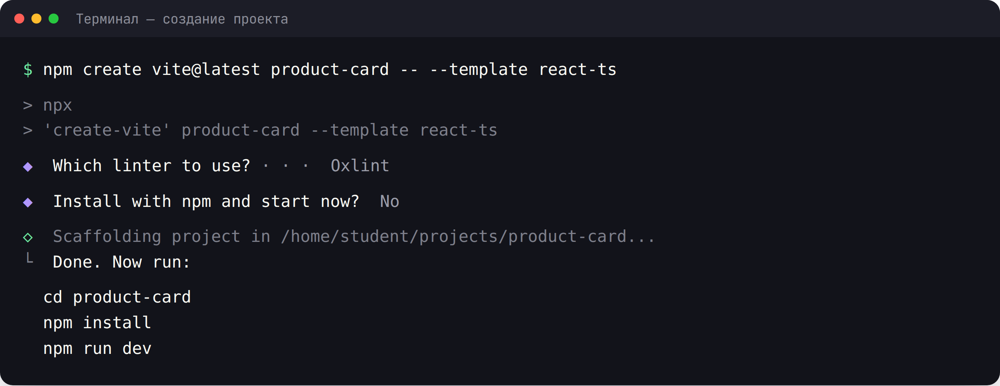
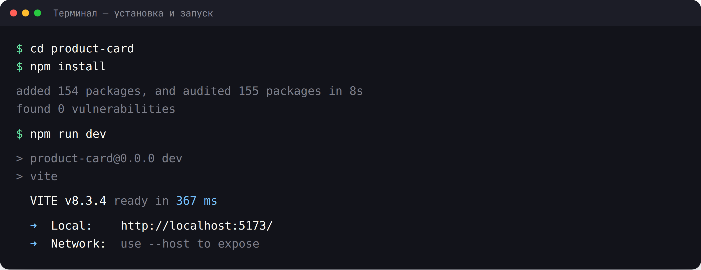
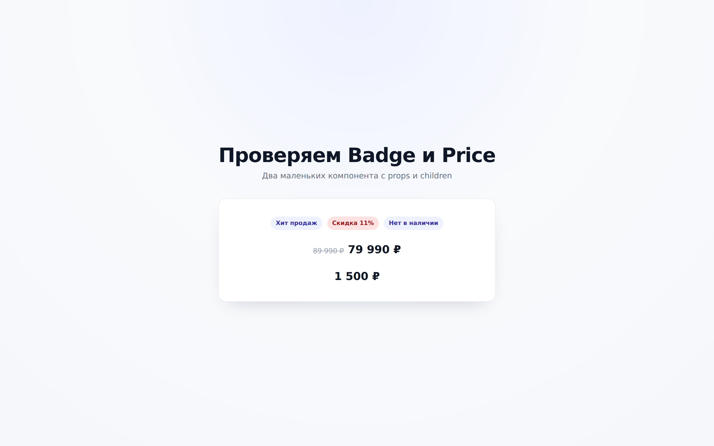
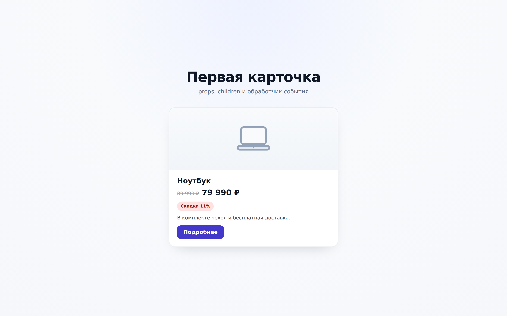
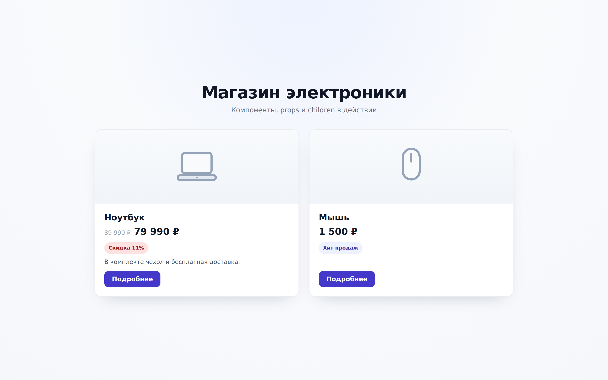
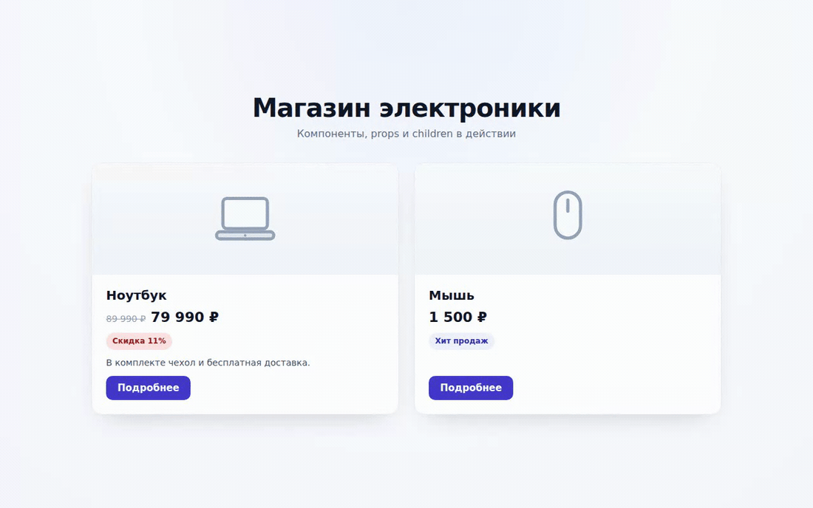
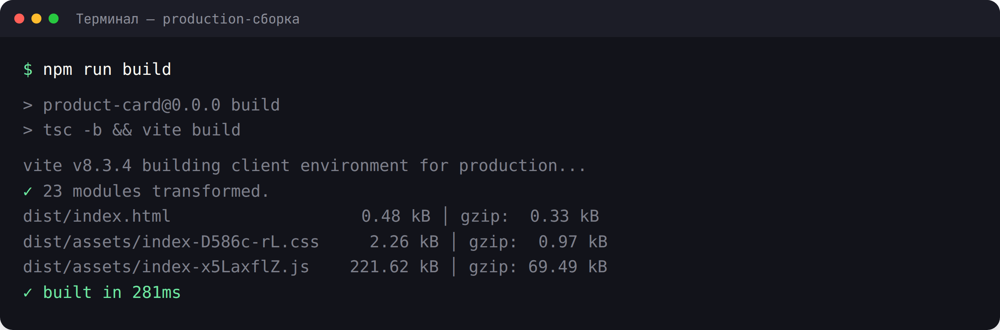

# Практическая работа 15. Создание компонентов

### **Тема:** Компоненты React — основные строительные блоки приложения

### **Цель:**
Научиться создавать функциональные компоненты в React, понимать их структуру и взаимодействие между ними. Освоить JSX, передачу данных через props, типизацию props с помощью TypeScript и композицию компонентов.

### **Теоретическая часть:**

**Компонент** в React — это функция, которая возвращает JSX-разметку. Компонент включает:
- **Функцию** — содержит логику и вычисления
- **JSX-разметку** — то, что функция возвращает
- **Props** — входные данные компонента
- **Стили** — CSS-файл, подключённый к компоненту

**Минимальный компонент:**
```tsx
function MyComponent() {
  return <div>Мой компонент</div>;
}
```

**Правила компонентов:**
- Имя компонента начинается с **заглавной буквы** — так React отличает компоненты от обычных HTML-тегов
- Компонент возвращает **один корневой элемент** (или Fragment `<>...</>`, если элементов несколько)
- Файлы компонентов называют с заглавной буквы: `Button.tsx`, `UserCard.tsx`
- Каталог `src/components/` — договорённость для хранения компонентов приложения

**Props и их типизация:**
```tsx
interface GreetingProps {
  name: string;        // обязательное свойство
  city?: string;       // необязательное свойство (знак вопроса)
}

function Greeting({ name, city }: GreetingProps) {
  return <p>Привет, {name}! Город: {city ?? 'не указан'}</p>;
}
```

**Экспорт и импорт компонентов:**
```tsx
// components/Button.tsx — именованный экспорт
export function Button() {
  return <button>Кнопка</button>;
}

// App.tsx — импорт
import { Button } from './components/Button';
```

**Композиция:** компоненты вкладываются друг в друга; props могут быть данными и JSX-разметкой, которую передают через `children`.

### **Ход работы:**

1. Создать React-проект (Vite + TypeScript) и установить зависимости
2. Очистить демонстрационный шаблон Vite
3. Описать тип данных и props компонента (в примере — `Product`)
4. Создать компоненты `Badge` и `Price`
5. Создать компонент `ProductCard` с типизированными props и `children`
6. Собрать страницу в `App.tsx`, добавить стили
7. Проверить работу в браузере: данные, скидку, `children` и композицию
8. Выполнить production-сборку
9. Оформить `README.md` и подготовить работу к сдаче

Шаги ниже разобраны на примере карточки товара. Для своего варианта сохраните ту же последовательность: описать тип данных и props → собрать маленькие компоненты → сделать компонент-карточку → собрать страницу в `App.tsx` → проверить и собрать проект.

### **Пошаговая реализация: карточка товара**

Ниже — полный пример, который можно повторить целиком. В результате получится страница магазина электроники с двумя карточками товаров. На этом примере отрабатываются все темы лекции: функциональные компоненты, JSX, props, необязательные props, `children` и композиция.

Структура проекта к концу работы:

```text
product-card/
├── public/
│   └── images/
│       ├── laptop.svg
│       ├── mouse.svg
│       └── placeholder.svg
├── src/
│   ├── components/
│   │   ├── Badge.tsx
│   │   ├── Badge.css
│   │   ├── Price.tsx
│   │   ├── Price.css
│   │   ├── ProductCard.tsx
│   │   └── ProductCard.css
│   ├── types/
│   │   └── product.ts
│   ├── App.css
│   ├── App.tsx
│   ├── index.css
│   └── main.tsx
├── index.html
├── package.json
└── vite.config.ts
```

---

#### **Шаг 0. Создание проекта**

Откройте терминал в папке, где будет лежать проект, и выполните команду:

```bash
npm create vite@latest product-card -- --template react-ts
```

В примере проект создаётся в отдельной папке `product-card`. При сдаче работы можно создать проект в корне своего репозитория — команда для этого указана в разделе «Инструкция по сдаче работы».

На вопросы мастера ответьте так:

- **Which linter to use?** — `Oxlint`
- **Install with npm and start now?** — `No`



Перейдите в папку проекта, установите зависимости и запустите dev-сервер:

```bash
cd product-card
npm install
npm run dev
```



Vite выведет адрес `http://localhost:5173/`. Откройте его в браузере: пока это стандартная страница шаблона. Dev-сервер не нужно перезапускать после каждого изменения — Vite обновляет страницу автоматически (HMR). Остановить сервер можно сочетанием `Ctrl+C`.

---

#### **Шаг 1. Очищаем шаблон**

Удалите демонстрационную разметку и неиспользуемые картинки шаблона (содержимое `src/assets/`). Файлы `src/App.css` и `src/App.tsx` замените полностью. В `index.html` поменяйте заголовок вкладки:

```html
<title>Магазин электроники</title>
```

Замените глобальные стили в `src/index.css`:

```css
:root {
  font-family: 'Segoe UI', system-ui, -apple-system, sans-serif;
  color: #101828;
  background: #f5f7fb;
  font-synthesis: none;
  text-rendering: optimizeLegibility;
  -webkit-font-smoothing: antialiased;
  -moz-osx-font-smoothing: grayscale;
}

* {
  box-sizing: border-box;
}

body {
  min-width: 320px;
  min-height: 100vh;
  margin: 0;
  background: radial-gradient(circle at 50% 0%, #eef2ff 0%, #f8fafc 42%, #f5f7fb 100%);
}

#root {
  min-height: 100vh;
}

h1,
h2,
h3,
p {
  margin: 0;
}

button {
  font-family: inherit;
}
```

Пока в `src/App.tsx` достаточно заглушки:

```tsx
function App() {
  return <h1>Магазин электроники</h1>;
}

export default App;
```

Сохраните файл — в браузере сразу появится заголовок. `src/main.tsx` менять не нужно: он подключает `index.css` и рендерит `<App />` в `#root`.

Добавьте изображения товаров в `public/images/`. В материалах работы они лежат в папке `assets/practical-15/images/`: [laptop.svg](assets/practical-15/images/laptop.svg), [mouse.svg](assets/practical-15/images/mouse.svg) и [placeholder.svg](assets/practical-15/images/placeholder.svg). Скопируйте их в проект или используйте свои картинки — тогда поправьте пути в поле `imageUrl`.

---

#### **Шаг 2. Описываем тип товара**

Создайте файл `src/types/product.ts`. Тип описывает данные, которые карточка получает через props:

```ts
export interface Product {
  id: number;
  title: string;
  price: number;
  oldPrice?: number;
  discount?: number;
  imageUrl?: string;
  isAvailable: boolean;
}
```

Знак `?` делает свойство необязательным: у мыши может не быть старой цены и скидки, а картинка может отсутствовать — тогда покажем заглушку.

---

#### **Шаг 3. Компонент `Badge`**

`Badge` — маленький компонент-метка. Он принимает содержимое через `children`, а внешний вид — через необязательный prop `variant`.

`src/components/Badge.tsx`:

```tsx
import type { ReactNode } from 'react';
import './Badge.css';

interface BadgeProps {
  children: ReactNode;
  variant?: 'default' | 'danger';
}

export function Badge({ children, variant = 'default' }: BadgeProps) {
  return <span className={`badge badge--${variant}`}>{children}</span>;
}
```

`src/components/Badge.css`:

```css
.badge {
  display: inline-flex;
  align-items: center;
  padding: 4px 10px;
  border-radius: 999px;
  font-size: 12px;
  font-weight: 600;
  line-height: 1.6;
  background: #eef2ff;
  color: #3730a3;
}

.badge--danger {
  background: #fee2e2;
  color: #991b1b;
}
```

Разберите код:

- `children: ReactNode` — всё, что пользователь положит между `<Badge>` и `</Badge>`;
- `variant = 'default'` — значение по умолчанию для необязательного prop;
- `` className={`badge badge--${variant}`} `` — шаблонная строка собирает CSS-класс;
- `import './Badge.css'` подключает стили именно этого компонента.

---

#### **Шаг 4. Компонент `Price`**

`Price` показывает текущую цену и, если она передана, старую зачёркнутую цену. Форматирование вынесено в отдельную функцию — так компонент остаётся чистым и читаемым.

`src/components/Price.tsx`:

```tsx
import './Price.css';

interface PriceProps {
  value: number;
  oldValue?: number;
}

function formatPrice(value: number) {
  return `${value.toLocaleString('ru-RU')} ₽`;
}

export function Price({ value, oldValue }: PriceProps) {
  return (
    <p className="price">
      {oldValue !== undefined && <s>{formatPrice(oldValue)}</s>}
      <strong>{formatPrice(value)}</strong>
    </p>
  );
}
```

`src/components/Price.css`:

```css
.price {
  display: flex;
  align-items: baseline;
  gap: 8px;
  margin: 0;
}

.price s {
  color: #98a2b3;
  font-size: 14px;
}

.price strong {
  color: #101828;
  font-size: 22px;
  line-height: 1.2;
}
```

Обратите внимание на условие `oldValue !== undefined`: если проверять просто `oldValue && ...`, то цена `0` не отобразится. `toLocaleString('ru-RU')` расставляет разряды: `79990` превращается в `79 990`.

**Проверка.** Временно выведите оба компонента в `App.tsx` и убедитесь, что метки и цены выглядят как на скриншоте. После проверки компоненты можно убрать — дальше они будут использоваться внутри карточки.



---

#### **Шаг 5. Компонент `ProductCard`**

Теперь соберём карточку из маленьких компонентов. Она принимает объект товара и необязательное содержимое `children`.

`src/components/ProductCard.tsx`:

```tsx
import type { ReactNode } from 'react';
import type { Product } from '../types/product';
import { Badge } from './Badge';
import { Price } from './Price';
import './ProductCard.css';

export interface ProductCardProps {
  product: Product;
  children?: ReactNode;
}

export function ProductCard({ product, children }: ProductCardProps) {
  const hasDiscount = product.discount !== undefined && product.discount > 0;

  return (
    <article className="product-card">
      <div className="product-card__media">
        
      </div>

      <div className="product-card__body">
        <h3 className="product-card__title">{product.title}</h3>
        <Price value={product.price} oldValue={product.oldPrice} />

        {(hasDiscount || !product.isAvailable) && (
          <div className="product-card__badges">
            {hasDiscount && <Badge variant="danger">Скидка {product.discount}%</Badge>}
            {!product.isAvailable && <Badge>Нет в наличии</Badge>}
          </div>
        )}

        {children && <div className="product-card__children">{children}</div>}

        <button
          className="product-card__button"
          type="button"
          disabled={!product.isAvailable}
        >
          Подробнее
        </button>
      </div>
    </article>
  );
}
```

`src/components/ProductCard.css`:

```css
.product-card {
  display: flex;
  flex-direction: column;
  overflow: hidden;
  background: #fff;
  border: 1px solid #eaecf0;
  border-radius: 16px;
  box-shadow: 0 16px 40px -24px rgba(16, 24, 40, 0.28);
}

.product-card__media {
  display: flex;
  align-items: center;
  justify-content: center;
  padding: 28px;
  background: linear-gradient(180deg, #f8fafc, #f1f5f9);
}

.product-card__image {
  width: 120px;
  height: 120px;
  object-fit: contain;
}

.product-card__body {
  display: flex;
  flex: 1;
  flex-direction: column;
  align-items: flex-start;
  gap: 10px;
  padding: 20px 22px 22px;
}

.product-card__title {
  margin: 0;
  color: #101828;
  font-size: 20px;
}

.product-card__badges {
  display: flex;
  flex-wrap: wrap;
  gap: 8px;
}

.product-card__children {
  color: #475467;
  font-size: 14px;
  line-height: 1.5;
}

.product-card__button {
  margin-top: auto;
  padding: 10px 18px;
  border: none;
  border-radius: 10px;
  background: #4338ca;
  color: #fff;
  font: inherit;
  font-size: 15px;
  font-weight: 600;
  cursor: pointer;
  transition: background-color 0.2s ease;
}

.product-card__button:hover:not(:disabled) {
  background: #3730a3;
}

.product-card__button:disabled {
  background: #cbd5e1;
  cursor: not-allowed;
}
```

Что здесь важно:

- `ProductCardProps` описывает входные данные компонента; `children` необязательный;
- `hasDiscount` — вычисляемое значение: скидка показывается только при `discount > 0`;
- `product.imageUrl ?? '/images/placeholder.svg'` — запасная картинка, если `imageUrl` нет;
- `children` рендерится внутри карточки: так в неё можно передать текст, описание или другой компонент;
- `margin-top: auto` у кнопки прижимает её к низу карточки, поэтому кнопки в карточках разной высоты выравниваются;
- обёртка `.product-card__body` — практическое улучшение по сравнению с минимальным примером из лекции: она задаёт колонку и управляет отступами.

Чтобы проверить карточку до сборки всей страницы, временно выведите её в `App.tsx` с одним объектом:

```tsx
const laptop: Product = {
  id: 1,
  title: 'Ноутбук',
  price: 79990,
  oldPrice: 89990,
  discount: 11,
  imageUrl: '/images/laptop.svg',
  isAvailable: true,
};

<ProductCard product={laptop}>
  <p>В комплекте чехол и бесплатная доставка.</p>
</ProductCard>
```

Не забудьте импортировать в `App.tsx` сам компонент и тип: `import { ProductCard } from './components/ProductCard';` и `import type { Product } from './types/product';`. Стили обёртки `.app` появятся на следующем шаге — до этого карточка отобразится без выравнивания по центру.



---

#### **Шаг 6. Собираем страницу в `App.tsx`**

Осталось собрать данные и расположить карточки на странице.

`src/App.tsx`:

```tsx
import './App.css';
import { Badge } from './components/Badge';
import { ProductCard } from './components/ProductCard';
import type { Product } from './types/product';

const products: Product[] = [
  {
    id: 1,
    title: 'Ноутбук',
    price: 79990,
    oldPrice: 89990,
    discount: 11,
    imageUrl: '/images/laptop.svg',
    isAvailable: true,
  },
  {
    id: 2,
    title: 'Мышь',
    price: 1500,
    imageUrl: '/images/mouse.svg',
    isAvailable: true,
  },
];

function App() {
  return (
    <div className="app">
      <header className="app__header">
        <h1>Магазин электроники</h1>
        <p>Компоненты, props и children в действии</p>
      </header>

      <div className="product-grid">
        <ProductCard product={products[0]}>
          <p>В комплекте чехол и бесплатная доставка.</p>
        </ProductCard>

        <ProductCard product={products[1]}>
          <Badge>Хит продаж</Badge>
        </ProductCard>
      </div>
    </div>
  );
}

export default App;
```

`src/App.css`:

```css
.app {
  display: flex;
  flex-direction: column;
  justify-content: center;
  min-height: 100vh;
  max-width: 1040px;
  margin: 0 auto;
  padding: 56px 24px;
}

.app__header {
  margin-bottom: 36px;
  text-align: center;
}

.app__header h1 {
  margin: 0 0 8px;
  color: #101828;
  font-size: 40px;
  letter-spacing: -1px;
}

.app__header p {
  margin: 0;
  color: #667085;
  font-size: 16px;
}

.product-grid {
  display: grid;
  grid-template-columns: repeat(2, minmax(0, 1fr));
  gap: 24px;
}

@media (max-width: 760px) {
  .product-grid {
    grid-template-columns: 1fr;
  }
}
```

Разберите, как устроена страница:

- массив `products` хранится в родителе и передаётся вниз через prop `product`;
- каждая карточка получает объект `product` и необязательный `children`;
- в первой карточке `children` — абзац с описанием, во второй — компонент `Badge`;
- карточки ничего не знают о том, откуда взялись данные: они просто отображают то, что получили;
- `grid` с `repeat(2, minmax(0, 1fr))` даёт две колонки, а медиазапрос переключает их в одну на узких экранах.

Откройте страницу в браузере. Должно получиться так:



**Живая демонстрация.** Две карточки, собранные из компонентов, props и `children`:



Проверьте сценарии:

1. У ноутбука видны старая цена, новая цена, скидка 11% и описание из `children`.
2. У мыши нет старой цены и скидки, а бейдж «Хит продаж» передан через `children`.
3. Сузьте окно браузера — карточки перестроятся в одну колонку.

Кнопка «Подробнее» в примере статическая: обработчики событий в этой работе не требуются.

---

#### **Шаг 7. Production-сборка**

Проверьте, что проект собирается без ошибок TypeScript:

```bash
npm run build
```



Команда `build` выполняет `tsc -b && vite build`: сначала проверяет типы, затем собирает оптимизированную версию в папку `dist/`. Посмотреть результат локально можно командой:

```bash
npm run preview
```

---

#### **Шаг 8. README и подготовка к сдаче**

Создайте `README.md` в корне проекта: укажите вариант задания, перечислите компоненты, опишите props и добавьте скриншоты результата. Готовый шаблон README для варианта 1 приведён ниже, в разделе «Пример README.md для варианта 1».

Перед сдачей проверьте проект по чек-листу:

- [ ] проект запускается командой `npm run dev`;
- [ ] `npm run build` проходит без ошибок TypeScript;
- [ ] имена компонентов начинаются с заглавной буквы;
- [ ] props не изменяются внутри компонентов;
- [ ] все props типизированы, необязательные помечены `?`;
- [ ] использована композиция: компонент вложен в другой или передан через `children`;
- [ ] нет обработчиков событий и состояния;
- [ ] у каждого компонента есть свой CSS-файл или стили в `App.css`;
- [ ] в README есть описание работы и скриншоты;
- [ ] изменения закоммичены и отправлены в репозиторий.

---

#### **Частые ошибки**

| Ошибка | Причина | Решение |
|--------|---------|---------|
| `<productcard />` не отображается | Имя компонента написано со строчной буквы | Писать `<ProductCard />`: React считает строчные теги HTML-элементами |
| Стили не применяются | Забыт импорт CSS | Добавить `import './ProductCard.css'` в файл компонента |
| `Cannot read properties of undefined` | В компонент не передан обязательный prop | Проверить передачу `product` и тип `ProductCardProps` |
| Старая цена видна всегда | Неверное условие | Проверять `oldValue !== undefined`, а не `oldValue` |
| `children` не отображается | Забыли вставить `{children}` в JSX | Добавить `{children}` в разметку компонента |
| TypeScript ругается на props | Нет типа или пропущено поле | Описать `interface ...Props` и передать все обязательные поля |
| Кнопка «прыгает» в карточках разной высоты | Нет выравнивания | Добавить `margin-top: auto` и `display: flex` для колонки |

---

## **Варианты заданий:**

Все варианты рассчитаны только на материал лекций 15–16 и предыдущих разделов. Можно использовать компоненты, JSX, props, `children`, типы TypeScript и CSS (Flexbox и Grid). Обработчики событий, `useState` и другие хуки, `map`/`filter` для вывода списков, формы с валидацией, роутинг и Context пока не нужны — эти темы будут в следующих лекциях.

Данные храните в константах и передавайте через props. Несколько однотипных элементов выводите статической разметкой. Кнопки и ссылки могут присутствовать в разметке, но без `onClick` и других обработчиков.

В каждом варианте требуется:

- создать функциональный компонент (или 2–3 маленьких компонента) в `src/components/`;
- описать props через `interface`, необязательные свойства пометить `?`;
- использовать `children`, если он указан в задании;
- подключить CSS и оформить результат;
- вывести компонент в `App.tsx` с тестовыми данными;
- добавить скриншот результата в `README.md`.

### **Вариант 1: Компонент карточки пользователя**

Компонент `UserCard`:

- props: `name`, `role`, `email`, `avatarUrl`, `children?`;
- аватар, имя, роль и email;
- кнопка «Написать сообщение» без обработчика — достаточно статической разметки;
- `children` — дополнительная информация под email (например, город или телефон).

### **Вариант 2: Компонент прогресс-бара**

Компонент `ProgressBar`:

- props: `value` (число от 0 до 100), `label`, `color?`;
- подпись, процент и полоса заполнения;
- ширина полосы задаётся через `style={{ width: `${value}%` }}`;
- вывести на странице 3 полосы с разными значениями и цветами;
- анимация не требуется.

### **Вариант 3: Компонент модального окна**

Компонент `Modal`:

- props: `title`, `children`;
- карточка с заголовком, содержимым и статическими кнопками «ОК» и «Отмена»;
- компонент всегда отображается на странице (имитация открытого окна, без состояния);
- затемнение фона и центрирование — по желанию, через CSS;
- обработчики кнопок не нужны.

### **Вариант 4: Компонент рейтинга**

Компонент `Rating`:

- props: `value` (целое число от 0 до 5), `reviews?`, `children?`;
- звёзды выводятся выражением `'★'.repeat(value)` и `'☆'.repeat(5 - value)`;
- рядом показано число отзывов;
- `children` — текст отзыва;
- выбор оценки не нужен: рейтинг только отображается.

### **Вариант 5: Компонент навигационного меню**

Компонент `NavMenu`:

- props: `active` (`'home' | 'catalog' | 'about' | 'contacts'`);
- логотип и четыре ссылки: «Главная», «Каталог», «О нас», «Контакты»;
- активная ссылка получает отдельный CSS-класс через сравнение `active === 'home'`;
- ссылки оформлены как статическая разметка, без перехода и обработчиков;
- меню оформлено через Flexbox, на узком экране — в колонку.

### **Вариант 6: Компонент формы входа**

Компонент `LoginForm`:

- props: `title?`, `buttonText?`;
- поля email и пароль (обычные `<input>`, без состояния и проверок);
- статическая кнопка «Войти»;
- ссылка «Забыли пароль?» передаётся через `children`;
- валидация, отправка данных и обработчики не требуются.

### **Вариант 7: Компонент списка задач**

Компоненты `TodoList` и `TodoItem`:

- `TodoList`: props `title`, `children`;
- `TodoItem`: props `title`, `done`, `children?`;
- вывести три задачи статической разметкой;
- выполненная задача получает отдельный класс и галочку;
- кнопки и переключатели не нужны: статус приходит через prop `done`;
- добавление, удаление и фильтрация задач не требуются.

### **Вариант 8: Компонент галереи изображений**

Компоненты `Gallery` и `PhotoCard`:

- `Gallery`: props `title`, `children`;
- `PhotoCard`: props `src`, `alt`, `caption`;
- вывести 3–4 карточки с изображениями в сетке Grid;
- у каждой карточки есть подпись;
- модальное окно, навигация и индикатор не требуются.

### **Вариант 9: Компонент аккордеона**

Компонент `AccordionItem`:

- props: `title`, `children`;
- используйте нативные HTML-элементы `<details>` и `<summary>` — они раскрываются средствами браузера, без React-состояния и обработчиков;
- вывести три секции с вопросами и ответами;
- оформить маркер, границы и отступы через CSS.

### **Вариант 10: Компонент поиска**

Компонент `SearchBar`:

- props: `placeholder?`, `buttonText?`, `children?`;
- поле ввода и статическая кнопка «Найти»;
- `children` — подсказка под полем (например, «Например: ноутбук»);
- автодополнение, история, загрузка и обработчики не требуются.

### **Вариант 11: Компонент уведомлений**

Компоненты `Notification` и `NotificationStack`:

- `Notification`: props `type` (`'success' | 'error' | 'warning' | 'info'`), `title`, `children?`;
- `NotificationStack`: props `children`;
- вывести три уведомления разных типов статической разметкой;
- цвет и иконка зависят от `type`;
- кнопка «×» может быть в разметке, но без обработчика;
- автоматическое скрытие и добавление уведомлений не требуются.

### **Вариант 12: Компонент недельного календаря**

Компоненты `CalendarWeek` и `CalendarDay`:

- `CalendarWeek`: props `month`, `year`, `children`;
- `CalendarDay`: props `weekday`, `day`, `active?`;
- вывести семь дней недели статической разметкой;
- активный день выделен цветом;
- переключение месяцев, выбор диапазона и обработчики не требуются.

### **Вариант 13: Компонент пагинации**

Компонент `Pagination`:

- props: `currentPage` (от 1 до 5);
- кнопки «Назад», номера страниц 1–5 и кнопка «Вперёд»;
- текущая страница выделена;
- кнопки статические, без обработчиков;
- номера страниц можно записать вручную, без массива и `map`.

### **Вариант 14: Компонент загрузки файлов**

Компоненты `UploadZone` и `FileRow`:

- `UploadZone`: props `title`, `hint?`, `children?`;
- `FileRow`: props `name`, `size`, `status`;
- пунктирная область с иконкой и статической кнопкой «Выбрать файл»;
- вывести две строки с файлами статической разметкой;
- реальная загрузка, drag & drop, прогресс и обработчики не требуются.

### **Вариант 15: Компонент счётчика**

Компонент `Counter`:

- props: `value`, `min?`, `max?`;
- кнопки «−» и «+», между ними текущее значение;
- кнопки блокируются через `disabled`, если достигнут `min` или `max`;
- значение приходит через props и не меняется: обработчики не нужны;
- `useState` не используется.

---

## **Критерии оценки:**

### **5 (Отлично):**
- Все компоненты созданы согласно заданию и отображают переданные данные
- Компонент выведен в `App.tsx`, обязательные и необязательные props работают
- Props типизированы через TypeScript, необязательные помечены `?`
- `children` и композиция использованы там, где указано в задании
- Соблюдены правила React: компоненты с заглавной буквы, props не изменяются, используется композиция
- Нет обработчиков событий, `useState`, хуков, `map` и других непройденных тем
- Аккуратная стилизация: Flexbox, Grid, отступы, состояния hover и disabled
- Понятная структура файлов, осмысленные имена
- README.md с описанием, скриншотом и инструкцией запуска

### **4 (Хорошо):**
- Основные компоненты созданы и данные отображаются
- Props в целом типизированы, есть 1–2 неточности
- `children` и композиция использованы частично
- Стилизация есть, но не все состояния оформлены
- README.md содержит основную информацию
- Использованы только пройденные темы или есть незначительные отступления

### **3 (Удовлетворительно):**
- Создан минимум компонентов, часть данных не отображается
- Типизация неполная или отсутствует
- Стилизация минимальная
- README.md оформлен неполностью
- Есть ошибки в использовании props или композиции

### **2 (Неудовлетворительно):**
- Компоненты не созданы или не работают
- Код не соответствует требованиям
- Отсутствует стилизация
- README.md отсутствует или неинформативен

---

## **Контрольные вопросы:**

1. Что такое компонент в React и из каких частей он состоит?
2. Чем функциональный компонент отличается от обычной JavaScript-функции? Как React понимает, что это компонент?
3. Что такое JSX? Какие отличия JSX от HTML вы знаете?
4. Как передать данные в компонент от родителя?
5. Что такое props? Можно ли изменять props внутри компонента и почему?
6. Что такое композиция компонентов? Приведите пример.
7. Как типизировать props с помощью TypeScript?
8. Что произойдёт, если назвать функцию-компонент с маленькой буквы?
9. Сколько корневых элементов может вернуть компонент? Что делать, если нужно вернуть несколько элементов?
10. В чём разница между именованным экспортом и экспортом по умолчанию?
11. Как подключить стили к компоненту?
12. Где в проекте размещать изображения, которые должны попасть в сборку?
13. Как вывести значение переменной в JSX?
14. Что такое `children` и как передать содержимое в компонент?
15. Почему в JSX используется `className`, а не `class`?

---

## **Файловая структура проекта:**

```
practical-work-15-components/
│
├── assets/
│   └── images/                     # Скриншоты для README
├── public/
│   └── images/                     # Статические изображения
├── src/
│   ├── components/
│   │   ├── ProductCard.tsx         # Компоненты примера (замените на свои)
│   │   ├── ProductCard.css
│   │   ├── Badge.tsx
│   │   ├── Badge.css
│   │   ├── Price.tsx
│   │   └── Price.css
│   ├── types/
│   │   └── product.ts              # Типы данных примера
│   ├── App.css
│   ├── App.tsx
│   ├── index.css
│   └── main.tsx
│
├── .gitignore
├── index.html
├── package.json
├── tsconfig.json
├── tsconfig.app.json
├── tsconfig.node.json
└── vite.config.ts
```

---

## **Пример README.md для варианта 1:**

```markdown
# Практическая работа 15. Создание компонентов в React

## Вариант 1: Компонент карточки пользователя

### Задание:
Создать компонент `UserCard`, который отображает:
- аватар;
- имя;
- роль;
- email;
- дополнительную информацию через `children`;
- статическую кнопку «Написать сообщение» (без обработчика).

### Реализация:

#### src/components/UserCard.tsx
```tsx
import type { ReactNode } from 'react';
import './UserCard.css';

interface UserCardProps {
  name: string;
  role: string;
  email: string;
  avatarUrl: string;
  children?: ReactNode;
}

export function UserCard({
  name,
  role,
  email,
  avatarUrl,
  children,
}: UserCardProps) {
  return (
    <article className="user-card">
      

      <div className="user-card__info">
        <h3 className="user-card__name">{name}</h3>
        <p className="user-card__role">{role}</p>
        <a className="user-card__email" href={`mailto:${email}`}>
          {email}
        </a>
        {children && <div className="user-card__extra">{children}</div>}
      </div>

      <button className="user-card__button" type="button">
        Написать сообщение
      </button>
    </article>
  );
}
```

#### src/components/UserCard.css
```css
.user-card {
  display: flex;
  flex-direction: column;
  align-items: center;
  gap: 12px;
  width: 100%;
  max-width: 320px;
  padding: 20px;
  border: 1px solid #e2e8f0;
  border-radius: 12px;
  background: #fff;
  box-shadow: 0 4px 12px rgba(15, 23, 42, 0.08);
  transition: transform 0.2s ease, box-shadow 0.2s ease;
}

.user-card:hover {
  transform: translateY(-2px);
  box-shadow: 0 8px 20px rgba(15, 23, 42, 0.12);
}

.user-card__avatar {
  width: 80px;
  height: 80px;
  border-radius: 50%;
  object-fit: cover;
  border: 3px solid #2563eb;
}

.user-card__info {
  display: flex;
  flex-direction: column;
  align-items: center;
  gap: 4px;
  text-align: center;
}

.user-card__name {
  margin: 0;
  font-size: 1.2rem;
  color: #1e293b;
}

.user-card__role {
  margin: 0;
  font-size: 0.9rem;
  font-weight: 500;
  color: #2563eb;
}

.user-card__email {
  font-size: 0.9rem;
  color: #64748b;
  text-decoration: none;
}

.user-card__email:hover {
  text-decoration: underline;
}

.user-card__extra {
  width: 100%;
  margin-top: 8px;
  padding-top: 12px;
  border-top: 1px solid #e2e8f0;
  font-size: 0.9rem;
  color: #64748b;
}

.user-card__button {
  width: 100%;
  padding: 10px 16px;
  border: none;
  border-radius: 8px;
  background: #2563eb;
  color: #fff;
  font: inherit;
  cursor: pointer;
  transition: background-color 0.2s ease;
}

.user-card__button:hover {
  background: #1d4ed8;
}

.user-card__button:focus-visible {
  outline: 2px solid #93c5fd;
  outline-offset: 2px;
}
```

#### Использование в src/App.tsx
```tsx
import './App.css';
import { UserCard } from './components/UserCard';

function App() {
  return (
    <div className="container">
      <UserCard
        name="Иван Петров"
        role="Студент"
        email="ivan.petrov@example.com"
        avatarUrl="https://i.pravatar.cc/150?img=12"
      >
        <p>Группа ИС-21, 3 курс</p>
      </UserCard>
    </div>
  );
}

export default App;
```

### Скриншоты результата:


### Запуск проекта:
```bash
npm install
npm run dev
```

Приложение будет доступно по адресу: `http://localhost:5173`
```

---

## **Инструкция по сдаче работы:**

1. Создать репозиторий на Gogs
2. Клонировать репозиторий локально
3. Создать React-проект в папке репозитория:
   ```bash
   npm create vite@latest . -- --template react-ts
   npm install
   ```
4. Реализовать компоненты согласно варианту
5. Сделать коммиты с понятными сообщениями
6. Добавить скриншоты работы в папку `assets/images`
7. Оформить README.md
8. Запушить изменения в Gogs
9. Предоставить ссылку на репозиторий преподавателю
