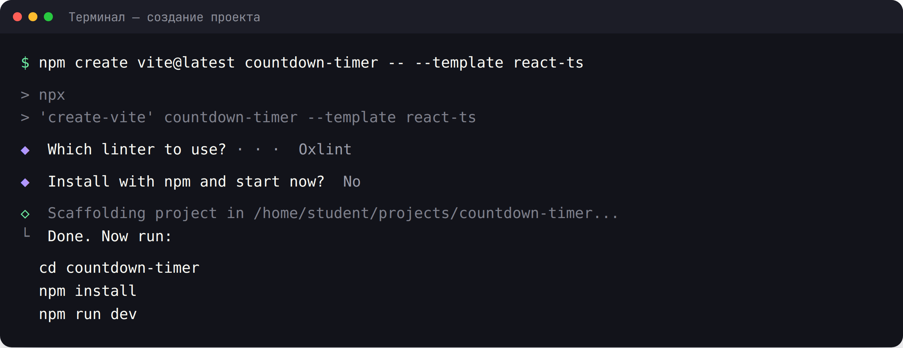
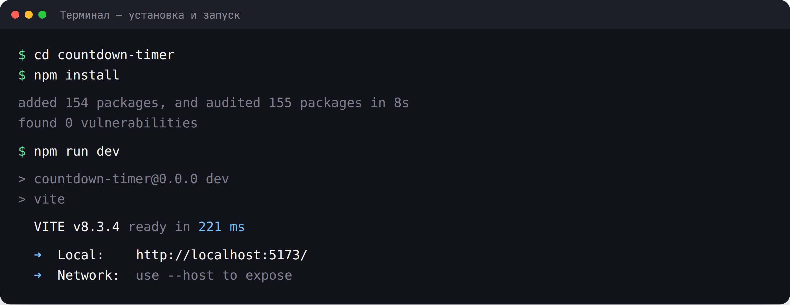
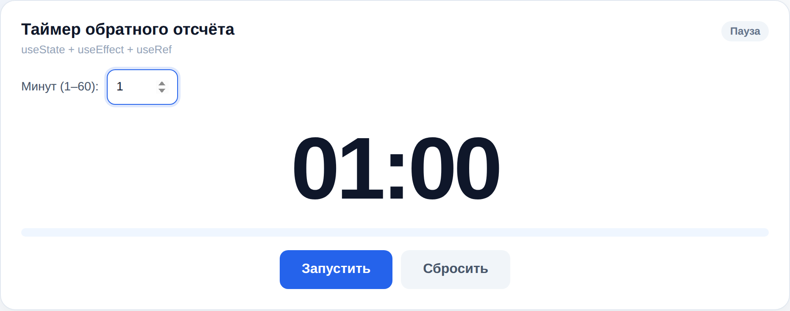
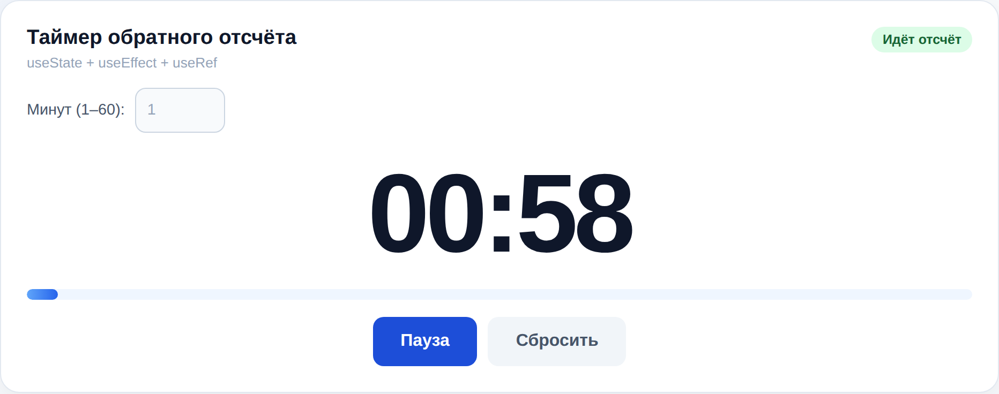
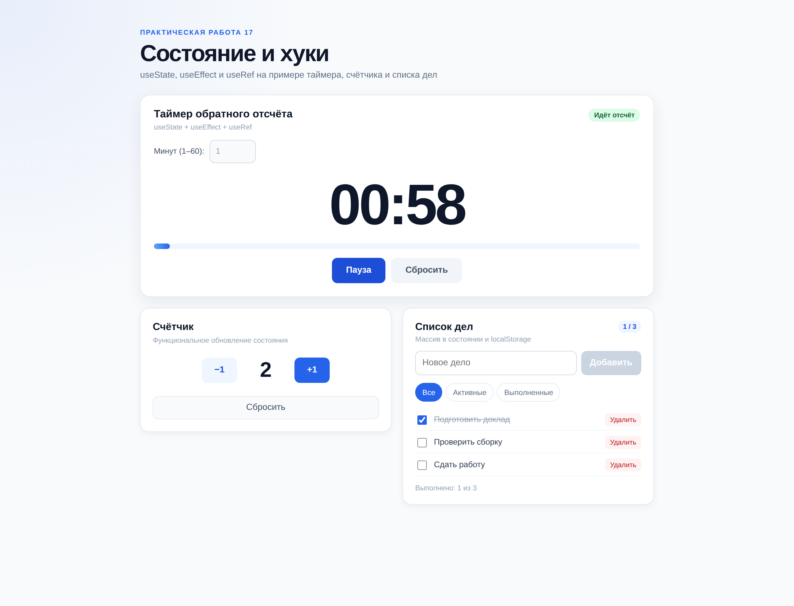
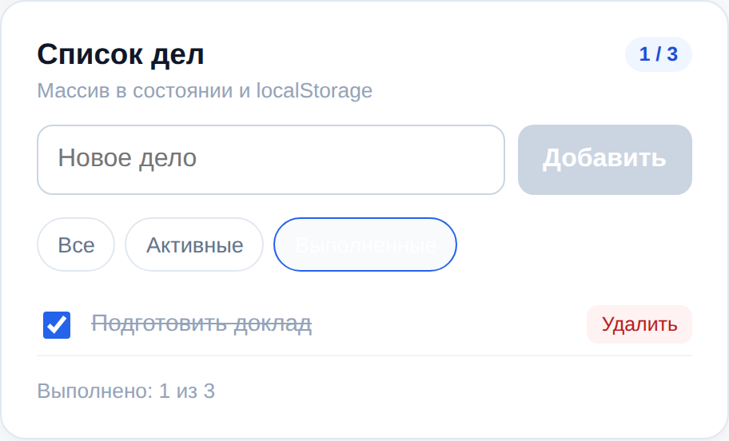
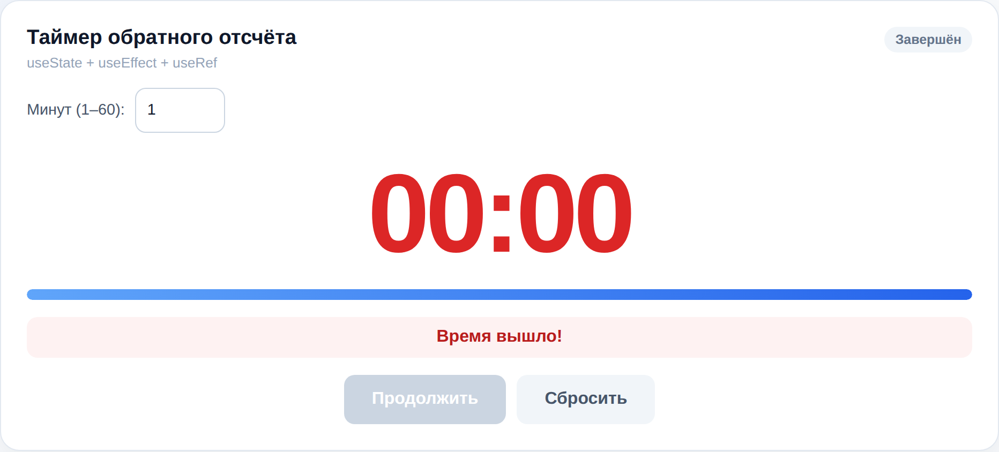
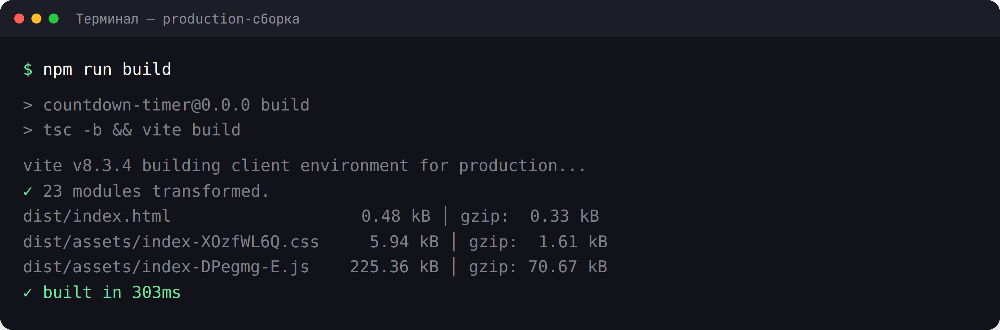

# Практическая работа 17. Состояние и хуки

### **Тема:** Состояние компонента и хуки `useState`, `useEffect`, `useRef`

### **Цель:**
Научиться хранить и изменять состояние компонента, выполнять побочные эффекты и работать с DOM-ссылками. Освоить хуки `useState`, `useEffect` и `useRef`: функциональные обновления состояния, массив зависимостей эффекта, функцию очистки (cleanup), автофокус полей и сохранение данных между перезагрузками страницы.

### **Теоретическая часть:**

**Состояние (state)** — это внутренняя память компонента. В отличие от props, состояние принадлежит самому компоненту и может меняться. Когда состояние меняется, React автоматически перерисовывает компонент. Состояние хранят с помощью хука `useState`.

**Хуки** — функции, которые дают компоненту возможности React. Правила хуков:
- вызывать хуки **только на верхнем уровне** компонента (не внутри условий, циклов, вложенных функций);
- вызывать хуки **только из компонентов React или из других хуков** (имя начинается с `use`).

**1. `useState` — создание состояния:**
```tsx
import { useState } from 'react';

function Counter() {
  const [count, setCount] = useState(0);

  return (
    <button onClick={() => setCount(count + 1)}>
      Нажато: {count}
    </button>
  );
}
```
`useState` возвращает массив из двух элементов: текущее значение и функцию-сеттер. Тип можно задать явно: `useState<number>(0)`.

**2. Функциональное обновление:**
```tsx
setCount((prev) => prev + 1);
```
Если новое значение зависит от предыдущего (особенно при нескольких обновлениях подряд), используйте функцию-обновитель — так React гарантированно возьмёт актуальное состояние.

**3. Ленивая инициализация:**
```tsx
const [value, setValue] = useState(() => computeExpensiveValue());
```
Функция выполнится только один раз — при первом рендере, а не при каждом.

**4. Состояние неизменяемо:**
```tsx
// Плохо: мутация массива
items.push(newItem);
setItems(items);

// Хорошо: новый массив
setItems((prev) => [...prev, newItem]);
```
React сравнивает ссылки, поэтому объекты и массивы нужно пересоздавать, а не изменять.

**5. `useEffect` — побочные эффекты:**
```tsx
import { useEffect } from 'react';

useEffect(() => {
  document.title = `Нажато: ${count}`;
}, [count]);
```
Третий аргумент — **массив зависимостей**:
- `[]` — эффект выполняется один раз после первого рендера;
- `[a, b]` — эффект перезапускается при изменении `a` или `b`;
- без массива — эффект выполняется после **каждого** рендера (обычно это ошибка).

**6. Очистка (cleanup):**
```tsx
useEffect(() => {
  const id = window.setInterval(() => {
    setSeconds((prev) => prev - 1);
  }, 1000);

  return () => window.clearInterval(id); // очистка
}, []);
```
Функция, возвращаемая из `useEffect`, вызывается перед следующим запуском эффекта и при размонтировании компонента. Обязательно очищайте таймеры, подписки, обработчики.

> В `StrictMode` (режим разработки) React монтирует компонент дважды, поэтому эффект выполнится два раза. Это особенность dev-режима и проверка на корректность cleanup, а не ошибка.

**7. `useRef` — ссылка на DOM и «память без рендера»:**
```tsx
import { useRef } from 'react';

function SearchField() {
  const inputRef = useRef<HTMLInputElement>(null);

  useEffect(() => {
    inputRef.current?.focus();
  }, []);

  return <input ref={inputRef} type="search" />;
}
```
Особенности `useRef`:
- `.current` можно изменять, и это **не вызывает** перерисовку;
- удобно для ссылок на DOM-узлы (`inputRef.current?.focus()`);
- удобно для хранения значения между рендерами (например, id таймера, счётчик попыток).

**8. Типизация хуков:**
```tsx
const [items, setItems] = useState<string[]>([]);
const timerRef = useRef<number | null>(null);
const inputRef = useRef<HTMLInputElement>(null);
```

**9. Порядок и зависимости:**
- Не указывайте в зависимостях то, что вы не используете внутри эффекта.
- Не забывайте про зависимости — это источник багов «устаревшего» состояния.
- Не выполняйте в `useEffect` то, что можно вычислить во время рендера.

### **Ход работы:**

1. Создать новый React-проект (Vite + TypeScript) командой `npm create vite@latest countdown-timer -- --template react-ts`
2. Изучить структуру проекта и удалить демо-код шаблона
3. Создать счётчик с кнопками «+1», «−1» и функциональным обновлением состояния
4. Создать таймер обратного отсчёта на `useState` + `useEffect` с корректным cleanup
5. Добавить паузу, продолжение и сброс таймера
6. Сохранять последнее введённое время в `localStorage` и восстанавливать при загрузке
7. Добавить автофокус поля ввода через `useRef`
8. Проверить работу в браузере (`npm run dev`), в том числе после перезагрузки страницы
9. Проверить сборку (`npm run build`) и линтер (`npm run lint`)
10. Оформить README.md с описанием работы

### **Пошаговая реализация: таймер, счётчик и список дел**

Ниже — полный пример, который можно повторить целиком. В результате получится небольшая панель с таймером обратного отсчёта, счётчиком и списком дел. Все три компонента используют состояние, а таймер и список дел сохраняют данные между перезагрузками страницы.

На этом примере отрабатываются:

- `useState` и функциональное обновление `setState((prev) => ...)`;
- ленивая инициализация состояния из `localStorage`;
- `useEffect` с массивом зависимостей и функцией очистки;
- `useRef` для DOM-ссылки и хранения id интервала;
- неизменяемое обновление массива объектов;
- вычисляемые значения во время рендера (без хранения в состоянии).

Структура проекта к концу работы:

```text
countdown-timer/
├── public/
├── src/
│   ├── components/
│   │   ├── Counter.tsx
│   │   ├── Counter.css
│   │   ├── CountdownTimer.tsx
│   │   ├── CountdownTimer.css
│   │   ├── TodoList.tsx
│   │   └── TodoList.css
│   ├── App.tsx
│   ├── App.css
│   ├── index.css
│   └── main.tsx
├── index.html
├── package.json
├── tsconfig.json
└── vite.config.ts
```

---

#### **Шаг 0. Создание и запуск проекта**

```bash
npm create vite@latest countdown-timer -- --template react-ts
cd countdown-timer
npm install
npm run dev
```





Откройте `http://localhost:5173/`. Демонстрационный шаблон Vite мы заменим.

---

#### **Шаг 1. Счётчик: `useState` и функциональное обновление**

`src/components/Counter.tsx`:


```tsx
import { useState } from 'react';
import './Counter.css';

interface CounterProps {
  initialValue?: number;
}

export function Counter({ initialValue = 0 }: CounterProps) {
  const [count, setCount] = useState(initialValue);

  return (
    <section className="counter">
      <h2 className="counter__title">Счётчик</h2>
      <p className="counter__hint">Функциональное обновление состояния</p>

      <div className="counter__row">
        <button
          type="button"
          className="counter__button counter__button--ghost"
          onClick={() => setCount((prev) => prev - 1)}
          aria-label="Уменьшить на один"
        >
          −1
        </button>

        <output className="counter__value">{count}</output>

        <button
          type="button"
          className="counter__button"
          onClick={() => setCount((prev) => prev + 1)}
          aria-label="Увеличить на один"
        >
          +1
        </button>
      </div>

      <button
        type="button"
        className="counter__reset"
        onClick={() => setCount(initialValue)}
      >
        Сбросить
      </button>
    </section>
  );
}
```


`src/components/Counter.css`:


```css
.counter {
  display: flex;
  flex-direction: column;
  gap: 14px;
  padding: 22px;
  border: 1px solid #e2e8f0;
  border-radius: 16px;
  background: #fff;
  box-shadow: 0 4px 12px rgba(15, 23, 42, 0.05);
}

.counter__title {
  margin: 0;
  color: #0f172a;
  font-size: 1.15rem;
}

.counter__hint {
  margin: -8px 0 0;
  color: #94a3b8;
  font-size: 0.82rem;
}

.counter__row {
  display: flex;
  align-items: center;
  justify-content: center;
  gap: 16px;
  padding: 10px 0;
}

.counter__value {
  min-width: 72px;
  color: #0f172a;
  font-size: 2.4rem;
  font-weight: 700;
  line-height: 1;
  text-align: center;
  font-variant-numeric: tabular-nums;
}

.counter__button {
  min-width: 64px;
  min-height: 46px;
  border: none;
  border-radius: 10px;
  background: #2563eb;
  color: #fff;
  font-size: 1rem;
  font-weight: 600;
  cursor: pointer;
  transition: background 0.2s ease;
}

.counter__button:hover {
  background: #1d4ed8;
}

.counter__button--ghost {
  background: #eff6ff;
  color: #1d4ed8;
}

.counter__button--ghost:hover {
  background: #dbeafe;
}

.counter__reset {
  min-height: 42px;
  border: 1px solid #e2e8f0;
  border-radius: 10px;
  background: #f8fafc;
  color: #475569;
  font: inherit;
  cursor: pointer;
}

.counter__reset:hover {
  background: #f1f5f9;
}
```


`initialValue` приходит через props и задаёт начальное значение. Кнопки вызывают `setCount` с функцией-обновителем: `prev` — это актуальное предыдущее значение, поэтому несколько обновлений подряд не потеряются.

---

#### **Шаг 2. Таймер: состояние и разметка**

`src/components/CountdownTimer.tsx`:


```tsx
import { useEffect, useRef, useState } from 'react';
import './CountdownTimer.css';

const STORAGE_KEY = 'countdown-minutes';

function readSavedMinutes(): number {
  const saved = window.localStorage.getItem(STORAGE_KEY);
  const parsed = Number(saved);

  return Number.isFinite(parsed) && parsed > 0 ? parsed : 1;
}

export function CountdownTimer() {
  const [minutes, setMinutes] = useState(readSavedMinutes);
  const [secondsLeft, setSecondsLeft] = useState(() => readSavedMinutes() * 60);
  const [isRunning, setIsRunning] = useState(false);
  const [isFinished, setIsFinished] = useState(false);

  const inputRef = useRef<HTMLInputElement>(null);
  const intervalRef = useRef<number | null>(null);

  useEffect(() => {
    inputRef.current?.focus();
  }, []);

  useEffect(() => {
    window.localStorage.setItem(STORAGE_KEY, String(minutes));
  }, [minutes]);

  useEffect(() => {
    if (!isRunning) {
      return;
    }

    intervalRef.current = window.setInterval(() => {
      setSecondsLeft((prev) => Math.max(prev - 1, 0));
    }, 1000);

    return () => {
      if (intervalRef.current !== null) {
        window.clearInterval(intervalRef.current);
        intervalRef.current = null;
      }
    };
  }, [isRunning]);

  useEffect(() => {
    if (secondsLeft === 0 && isRunning) {
      setIsRunning(false);
      setIsFinished(true);
    }
  }, [secondsLeft, isRunning]);

  const handleMinutesChange = (value: number) => {
    const safeValue = Math.min(Math.max(value, 1), 60);

    setMinutes(safeValue);
    setSecondsLeft(safeValue * 60);
    setIsRunning(false);
    setIsFinished(false);
  };

  const start = () => {
    if (secondsLeft > 0) {
      setIsRunning(true);
      setIsFinished(false);
    }
  };

  const pause = () => setIsRunning(false);

  const reset = () => {
    setIsRunning(false);
    setIsFinished(false);
    setSecondsLeft(minutes * 60);
  };

  const displayMinutes = String(Math.floor(secondsLeft / 60)).padStart(2, '0');
  const displaySeconds = String(secondsLeft % 60).padStart(2, '0');
  const progress =
    minutes > 0 ? ((minutes * 60 - secondsLeft) / (minutes * 60)) * 100 : 0;

  return (
    <section className="timer">
      <div className="timer__head">
        <div>
          <h2 className="timer__title">Таймер обратного отсчёта</h2>
          <p className="timer__hint">useState + useEffect + useRef</p>
        </div>

        <span className={isRunning ? 'timer__status timer__status--live' : 'timer__status'}>
          {isRunning ? 'Идёт отсчёт' : isFinished ? 'Завершён' : 'Пауза'}
        </span>
      </div>

      <label className="timer__field">
        Минут (1–60):
        <input
          ref={inputRef}
          type="number"
          min={1}
          max={60}
          value={minutes}
          disabled={isRunning}
          onChange={(event) => handleMinutesChange(Number(event.target.value))}
        />
      </label>

      <output className={`timer__display ${isFinished ? 'timer__display--done' : ''}`}>
        {displayMinutes}:{displaySeconds}
      </output>

      <div className="timer__progress" role="presentation">
        <div className="timer__progress-bar" style={{ width: `${progress}%` }} />
      </div>

      {isFinished && <p className="timer__message">Время вышло!</p>}

      <div className="timer__controls">
        {!isRunning ? (
          <button type="button" onClick={start} disabled={secondsLeft === 0}>
            {secondsLeft === minutes * 60 ? 'Запустить' : 'Продолжить'}
          </button>
        ) : (
          <button type="button" onClick={pause}>
            Пауза
          </button>
        )}

        <button type="button" className="timer__reset" onClick={reset}>
          Сбросить
        </button>
      </div>
    </section>
  );
}
```


В компоненте четыре куска состояния: `minutes`, `secondsLeft`, `isRunning`, `isFinished`. Вычисляемые значения — `displayMinutes`, `displaySeconds` и `progress` — не хранятся в состоянии, а считаются при каждом рендере.

---

#### **Шаг 3. Стили таймера**

`src/components/CountdownTimer.css`:


```css
.timer {
  display: flex;
  flex-direction: column;
  gap: 16px;
  padding: 24px;
  border: 1px solid #e2e8f0;
  border-radius: 18px;
  background: #fff;
  box-shadow: 0 10px 30px rgba(15, 23, 42, 0.07);
}

.timer__head {
  display: flex;
  align-items: flex-start;
  justify-content: space-between;
  gap: 12px;
}

.timer__title {
  margin: 0;
  color: #0f172a;
  font-size: 1.2rem;
}

.timer__hint {
  margin: 4px 0 0;
  color: #94a3b8;
  font-size: 0.82rem;
}

.timer__status {
  padding: 5px 10px;
  border-radius: 999px;
  background: #f1f5f9;
  color: #64748b;
  font-size: 0.78rem;
  font-weight: 600;
  white-space: nowrap;
}

.timer__status--live {
  background: #dcfce7;
  color: #166534;
}

.timer__field {
  display: flex;
  align-items: center;
  gap: 10px;
  color: #475569;
  font-size: 0.9rem;
}

.timer__field input {
  width: 84px;
  min-height: 42px;
  padding: 8px 10px;
  border: 1px solid #cbd5e1;
  border-radius: 10px;
  background: #fff;
  color: #0f172a;
  font: inherit;
  outline: none;
}

.timer__field input:focus {
  border-color: #2563eb;
  box-shadow: 0 0 0 3px rgba(37, 99, 235, 0.15);
}

.timer__field input:disabled {
  background: #f8fafc;
  color: #94a3b8;
}

.timer__display {
  padding: 8px 0 2px;
  color: #0f172a;
  font-size: clamp(4rem, 10vw, 6.5rem);
  font-weight: 800;
  letter-spacing: -4px;
  line-height: 1;
  text-align: center;
  font-variant-numeric: tabular-nums;
}

.timer__display--done {
  color: #dc2626;
}

.timer__progress {
  height: 10px;
  overflow: hidden;
  border-radius: 999px;
  background: #eff6ff;
}

.timer__progress-bar {
  height: 100%;
  border-radius: inherit;
  background: linear-gradient(90deg, #60a5fa, #2563eb);
  transition: width 0.35s ease;
}

.timer__message {
  margin: 0;
  padding: 10px 12px;
  border-radius: 10px;
  background: #fef2f2;
  color: #b91c1c;
  font-weight: 600;
  text-align: center;
}

.timer__controls {
  display: flex;
  flex-wrap: wrap;
  justify-content: center;
  gap: 10px;
}

.timer__controls button {
  min-height: 46px;
  padding: 10px 26px;
  border: none;
  border-radius: 10px;
  background: #2563eb;
  color: #fff;
  font: inherit;
  font-weight: 600;
  cursor: pointer;
  transition: background 0.2s ease;
}

.timer__controls button:hover {
  background: #1d4ed8;
}

.timer__controls button:disabled {
  background: #cbd5e1;
  cursor: not-allowed;
}

.timer__controls .timer__reset {
  background: #f1f5f9;
  color: #475569;
}

.timer__controls .timer__reset:hover {
  background: #e2e8f0;
}
```


Начальное состояние таймера: поле уже в фокусе благодаря `useRef`, на кнопке — «Запустить».



---

#### **Шаг 4. Эффекты таймера**

В `CountdownTimer` четыре эффекта, и у каждого своя задача:

1. **Автофокус при первом рендере.** Пустой массив зависимостей `[]` означает «выполнить один раз после монтирования»:

```tsx
useEffect(() => {
  inputRef.current?.focus();
}, []);
```

2. **Сохранение выбранного времени.** Эффект перезапускается только при изменении `minutes`:

```tsx
useEffect(() => {
  window.localStorage.setItem(STORAGE_KEY, String(minutes));
}, [minutes]);
```

3. **Интервал.** Эффект зависит от `isRunning`. При запуске создаётся `setInterval`, а возвращаемая функция очищает его при паузе и размонтировании:

```tsx
useEffect(() => {
  if (!isRunning) {
    return;
  }

  intervalRef.current = window.setInterval(() => {
    setSecondsLeft((prev) => Math.max(prev - 1, 0));
  }, 1000);

  return () => {
    if (intervalRef.current !== null) {
      window.clearInterval(intervalRef.current);
      intervalRef.current = null;
    }
  };
}, [isRunning]);
```

4. **Завершение.** Когда счётчик дошёл до нуля, эффект переводит таймер в состояние «Завершён»:

```tsx
useEffect(() => {
  if (secondsLeft === 0 && isRunning) {
    setIsRunning(false);
    setIsFinished(true);
  }
}, [secondsLeft, isRunning]);
```

Через две секунды после запуска:



> В `StrictMode` React в dev-режиме монтирует компонент дважды. Эффекты выполняются дважды, поэтому отсутствие cleanup сразу приводит к двум интервалам и ускоренному отсчёту. Проверяйте очистку.

---

#### **Шаг 5. Список дел: состояние-массив**

`src/components/TodoList.tsx`:


```tsx
import { useEffect, useState } from 'react';
import './TodoList.css';

interface Todo {
  id: number;
  title: string;
  done: boolean;
}

type Filter = 'all' | 'active' | 'done';

const STORAGE_KEY = 'todos';

function loadTodos(): Todo[] {
  try {
    const saved = window.localStorage.getItem(STORAGE_KEY);
    return saved ? (JSON.parse(saved) as Todo[]) : [];
  } catch {
    return [];
  }
}

export function TodoList() {
  const [todos, setTodos] = useState<Todo[]>(loadTodos);
  const [title, setTitle] = useState('');
  const [filter, setFilter] = useState<Filter>('all');

  useEffect(() => {
    try {
      window.localStorage.setItem(STORAGE_KEY, JSON.stringify(todos));
    } catch {
      // Игнорируем ошибки записи
    }
  }, [todos]);

  const addTodo = () => {
    const trimmed = title.trim();

    if (!trimmed) {
      return;
    }

    setTodos((prev) => [...prev, { id: Date.now(), title: trimmed, done: false }]);
    setTitle('');
  };

  const toggleTodo = (id: number) => {
    setTodos((prev) =>
      prev.map((todo) => (todo.id === id ? { ...todo, done: !todo.done } : todo)),
    );
  };

  const removeTodo = (id: number) => {
    setTodos((prev) => prev.filter((todo) => todo.id !== id));
  };

  const visibleTodos = todos.filter((todo) => {
    if (filter === 'active') {
      return !todo.done;
    }

    if (filter === 'done') {
      return todo.done;
    }

    return true;
  });

  const doneCount = todos.filter((todo) => todo.done).length;

  return (
    <section className="todo">
      <div className="todo__head">
        <div>
          <h2 className="todo__title">Список дел</h2>
          <p className="todo__hint">Массив в состоянии и localStorage</p>
        </div>
        <span className="todo__badge">
          {doneCount} / {todos.length}
        </span>
      </div>

      <div className="todo__form">
        <input
          type="text"
          value={title}
          onChange={(event) => setTitle(event.target.value)}
          onKeyDown={(event) => {
            if (event.key === 'Enter') {
              addTodo();
            }
          }}
          placeholder="Новое дело"
          aria-label="Новое дело"
        />
        <button type="button" onClick={addTodo} disabled={!title.trim()}>
          Добавить
        </button>
      </div>

      <div className="todo__filters">
        {(['all', 'active', 'done'] as const).map((value) => (
          <button
            key={value}
            type="button"
            className={
              filter === value ? 'todo__filter todo__filter--active' : 'todo__filter'
            }
            onClick={() => setFilter(value)}
          >
            {value === 'all' ? 'Все' : value === 'active' ? 'Активные' : 'Выполненные'}
          </button>
        ))}
      </div>

      {visibleTodos.length === 0 ? (
        <p className="todo__empty">Здесь пока ничего нет</p>
      ) : (
        <ul className="todo__list">
          {visibleTodos.map((todo) => (
            <li
              key={todo.id}
              className={todo.done ? 'todo__item todo__item--done' : 'todo__item'}
            >
              <label className="todo__label">
                <input
                  type="checkbox"
                  checked={todo.done}
                  onChange={() => toggleTodo(todo.id)}
                />
                <span>{todo.title}</span>
              </label>

              <button
                type="button"
                className="todo__delete"
                onClick={() => removeTodo(todo.id)}
                aria-label={`Удалить «${todo.title}»`}
              >
                Удалить
              </button>
            </li>
          ))}
        </ul>
      )}

      <p className="todo__stats">
        Выполнено: {doneCount} из {todos.length}
      </p>
    </section>
  );
}
```


Добавление, переключение и удаление не мутируют массив: `[...prev, newTodo]`, `map()` и `filter()` возвращают новые массивы. Иначе React может не заметить изменение и не перерисовать список.

---

#### **Шаг 6. Стили списка дел**

`src/components/TodoList.css`:


```css
.todo {
  display: flex;
  flex-direction: column;
  gap: 14px;
  padding: 22px;
  border: 1px solid #e2e8f0;
  border-radius: 16px;
  background: #fff;
  box-shadow: 0 4px 12px rgba(15, 23, 42, 0.05);
}

.todo__head {
  display: flex;
  align-items: flex-start;
  justify-content: space-between;
  gap: 10px;
}

.todo__title {
  margin: 0;
  color: #0f172a;
  font-size: 1.15rem;
}

.todo__hint {
  margin: 4px 0 0;
  color: #94a3b8;
  font-size: 0.82rem;
}

.todo__badge {
  padding: 4px 9px;
  border-radius: 999px;
  background: #eff6ff;
  color: #1d4ed8;
  font-size: 0.78rem;
  font-weight: 700;
}

.todo__form {
  display: flex;
  gap: 8px;
}

.todo__form input {
  flex: 1;
  min-width: 0;
  min-height: 44px;
  padding: 10px 12px;
  border: 1px solid #cbd5e1;
  border-radius: 10px;
  background: #fff;
  color: #0f172a;
  font: inherit;
  outline: none;
}

.todo__form input:focus {
  border-color: #2563eb;
  box-shadow: 0 0 0 3px rgba(37, 99, 235, 0.15);
}

.todo__form button {
  min-height: 44px;
  padding: 10px 16px;
  border: none;
  border-radius: 10px;
  background: #2563eb;
  color: #fff;
  font: inherit;
  font-weight: 600;
  cursor: pointer;
}

.todo__form button:disabled {
  background: #cbd5e1;
  cursor: not-allowed;
}

.todo__filters {
  display: flex;
  flex-wrap: wrap;
  gap: 6px;
}

.todo__filter {
  min-height: 34px;
  padding: 6px 12px;
  border: 1px solid #e2e8f0;
  border-radius: 999px;
  background: #fff;
  color: #64748b;
  font: inherit;
  font-size: 0.85rem;
  cursor: pointer;
}

.todo__filter:hover {
  background: #f8fafc;
}

.todo__filter--active {
  border-color: #2563eb;
  background: #2563eb;
  color: #fff;
}

.todo__empty {
  margin: 0;
  padding: 28px 16px;
  border: 1px dashed #cbd5e1;
  border-radius: 12px;
  background: #f8fafc;
  color: #94a3b8;
  text-align: center;
}

.todo__list {
  display: grid;
  gap: 2px;
  margin: 0;
  padding: 0;
  list-style: none;
}

.todo__item {
  display: flex;
  align-items: center;
  justify-content: space-between;
  gap: 8px;
  padding: 7px 0;
  border-bottom: 1px solid #f1f5f9;
}

.todo__label {
  display: flex;
  align-items: center;
  gap: 10px;
  color: #334155;
  font-size: 0.92rem;
  cursor: pointer;
}

.todo__label input {
  width: 17px;
  height: 17px;
  accent-color: #2563eb;
}

.todo__item--done .todo__label span {
  color: #94a3b8;
  text-decoration: line-through;
}

.todo__delete {
  padding: 5px 9px;
  border: none;
  border-radius: 7px;
  background: #fef2f2;
  color: #b91c1c;
  font: inherit;
  font-size: 0.78rem;
  cursor: pointer;
}

.todo__delete:hover {
  background: #fee2e2;
}

.todo__stats {
  margin: 0;
  color: #94a3b8;
  font-size: 0.82rem;
}
```


---

#### **Шаг 7. Сборка страницы**

`src/App.tsx`:


```tsx
import './App.css';
import { CountdownTimer } from './components/CountdownTimer';
import { Counter } from './components/Counter';
import { TodoList } from './components/TodoList';

function App() {
  return (
    <main className="app">
      <header className="app__header">
        <p className="app__eyebrow">Практическая работа 17</p>
        <h1>Состояние и хуки</h1>
        <p className="app__subtitle">
          useState, useEffect и useRef на примере таймера, счётчика и списка дел
        </p>
      </header>

      <CountdownTimer />

      <div className="app__grid">
        <Counter initialValue={0} />
        <TodoList />
      </div>
    </main>
  );
}

export default App;
```


`src/App.css`:


```css
.app {
  width: 100%;
  max-width: 980px;
  margin: 0 auto;
  padding: 52px 24px 72px;
}

.app__header {
  margin-bottom: 26px;
}

.app__eyebrow {
  margin: 0 0 8px;
  color: #2563eb;
  font-size: 0.78rem;
  font-weight: 700;
  letter-spacing: 0.12em;
  text-transform: uppercase;
}

.app__header h1 {
  margin: 0 0 8px;
  color: #0f172a;
  font-size: 42px;
  letter-spacing: -1.5px;
  line-height: 1.1;
}

.app__subtitle {
  margin: 0;
  color: #64748b;
  font-size: 1rem;
}

.app__grid {
  display: grid;
  grid-template-columns: repeat(auto-fit, minmax(320px, 1fr));
  gap: 20px;
  margin-top: 20px;
  align-items: start;
}
```


`src/index.css`:


```css
* {
  box-sizing: border-box;
}

html {
  min-width: 320px;
  background: #f8fafc;
}

body {
  margin: 0;
  min-width: 320px;
  min-height: 100vh;
  background:
    radial-gradient(circle at top left, rgba(37, 99, 235, 0.08), transparent 30%),
    #f8fafc;
  color: #0f172a;
  font-family: 'Segoe UI', Tahoma, Geneva, Verdana, sans-serif;
  -webkit-font-smoothing: antialiased;
}

button,
input,
select {
  font: inherit;
}
```


`src/main.tsx`:


```tsx
import { StrictMode } from 'react';
import { createRoot } from 'react-dom/client';
import './index.css';
import App from './App';

createRoot(document.getElementById('root')!).render(
  <StrictMode>
    <App />
  </StrictMode>,
);
```


Общий вид страницы: таймер сверху, счётчик и список дел — в двух колонках.



---

#### **Шаг 8. Проверка сценариев**

1. **Счётчик.** Нажмите «+1» два раза — значение станет `2`. Нажмите «−1» — вернётся `1`. «Сбросить» вернёт `0`.
2. **Таймер.** Нажмите «Запустить» — цифры уменьшаются, прогресс-бар растёт. Нажмите «Пауза» — отсчёт останавливается, кнопка меняется на «Продолжить».
3. **Завершение.** Дождитесь `00:00` — появится сообщение «Время вышло!», цифры станут красными.
4. **Список дел.** Добавьте три задачи, отметьте одну выполненной. Переключите фильтр «Выполненные» — останется только выполненная задача.



5. **Перезагрузка.** Обновите страницу: выбранное время и список дел должны восстановиться из `localStorage`.
6. **Завершённый таймер.** Если ускорить время в инструментах разработчика или дождаться нуля, состояние выглядит так:



---

#### **Шаг 9. Production-сборка**

```bash
npm run build
```



Сборка должна завершиться без ошибок TypeScript.

---

#### **Как это работает**

- **Состояние — это память компонента.** `useState` возвращает текущее значение и сеттер; вызов сеттера запускает перерисовку.
- **Функциональное обновление** `setCount((prev) => prev + 1)` использует актуальное предыдущее значение, а не «замороженное» из замыкания.
- **Ленивая инициализация** `useState(readSavedMinutes)` вызывает функцию только при первом рендере. Это удобно для чтения `localStorage`.
- **Эффект — это синхронизация с внешним миром.** Автофокус, `localStorage`, интервал и заголовок документа — побочные эффекты, их место в `useEffect`.
- **Массив зависимостей** определяет, когда эффект перезапускается. Пустой массив — один раз; `[isRunning]` — при каждом изменении `isRunning`.
- **Cleanup** возвращается из эффекта и вызывается перед следующим запуском и при размонтировании. Таймеры и подписки без cleanup «размножаются».
- **`useRef` не вызывает перерисовку.** В примере он хранит ссылку на input и id интервала.
- **Вычисляемые значения** (`displayMinutes`, `progress`) считаются во время рендера. Держать их в состоянии — значит дублировать данные и синхронизировать их вручную.
- **Массивы обновляются неизменяемо:** `map`, `filter`, spread. Мутация `push` не создаёт новый массив.

---

#### **Частые ошибки**

| Ошибка | Причина | Решение |
|--------|---------|---------|
| Таймер идёт в два раза быстрее | В `StrictMode` эффект выполнился дважды, cleanup отсутствует | Возвращать `clearInterval` из эффекта |
| После паузы создаётся второй интервал | Старый интервал не очищен | Очищать интервал в cleanup и при паузе |
| Счётчик не обновляется | Используется `count + 1` в нескольких вызовах подряд | Использовать `setCount((prev) => prev + 1)` |
| Список не перерисовывается | Массив мутирован через `push` | Создавать новый массив через spread/map/filter |
| `localStorage` перезаписывается пустым массивом | Эффект сохранения срабатывает при первом рендере | Это ожидаемо; для «первого запуска» используйте отдельный флаг |
| `inputRef.current` равен `null` | `ref` не привязан к DOM-элементу | Проверить `ref={inputRef}` и опциональную цепочку `?.` |
| Эффект выполняется на каждый рендер | Забыт массив зависимостей | Указать `[]` или нужные зависимости |
| TypeScript ругается на `setInterval` | В браузере `setInterval` возвращает `number`, в Node — `Timeout` | Использовать `window.setInterval` и `useRef<number \| null>` |

---

#### **Чек-лист перед сдачей**

- [ ] проект запускается командой `npm run dev`;
- [ ] `npm run build` проходит без ошибок TypeScript;
- [ ] используются `useState`, `useEffect` и `useRef`;
- [ ] есть функциональное обновление состояния;
- [ ] у эффектов указаны корректные зависимости;
- [ ] таймер очищает интервал через cleanup;
- [ ] данные сохраняются в `localStorage` и восстанавливаются после перезагрузки;
- [ ] массив обновляется без мутации;
- [ ] в README есть описание работы и скриншоты.

---

## **Варианты заданий:**

### **Вариант 1: Система уведомлений**
Создайте систему уведомлений:
- Состояние списка уведомлений через `useState`
- Автоматическое удаление уведомления через `setTimeout` в `useEffect` с cleanup
- Приоритеты и категории
- История всех показанных уведомлений

### **Вариант 2: Дашборд аналитики**
Создайте дашборд:
- Состояние метрик и выбранного периода
- Автообновление данных по таймеру (`useEffect` + cleanup)
- Фильтры по времени
- Индикатор последнего обновления

### **Вариант 3: Чат**
Создайте чат:
- Состояние списка сообщений и текста ввода
- Прокрутка к последнему сообщению через `useRef` + `useEffect`
- Индикатор «печатает...» с `setTimeout` и cleanup
- Счётчик новых сообщений

### **Вариант 4: Конструктор форм**
Создайте конструктор форм:
- Динамическое добавление и удаление полей (state-массив)
- Валидация в реальном времени
- Предпросмотр формы
- Показ итоговой JSON-схемы (вычисляется во время рендера)

### **Вариант 5: Планировщик задач**
Создайте планировщик:
- Добавление задач с датой и временем
- Напоминание через `setTimeout`/`setInterval` с cleanup
- Сохранение расписания в `localStorage` через `useEffect`
- Проверка пересечения интервалов

### **Вариант 6: Галерея изображений**
Создайте галерею:
- Ленивая загрузка по мере прокрутки (IntersectionObserver в `useEffect` с cleanup)
- Фильтры по категориям
- Счётчик просмотренных изображений
- Кнопка «Загрузить ещё» с индикатором

### **Вариант 7: Финансовый трекер**
Создайте трекер:
- Состояние списка транзакций
- Категории и бюджеты
- Сохранение в `localStorage`
- Индикатор превышения лимита с условной подсветкой

### **Вариант 8: Система тестирования**
Создайте систему тестов:
- Таймер прохождения (с cleanup, паузой и продолжением)
- Текущий вопрос и ответы в состоянии
- Реактивный прогресс
- Автопроверка и итоговый результат

### **Вариант 9: Погодный виджет**
Создайте виджет:
- Автообновление данных по интервалу
- Состояния «загрузка / успех / ошибка»
- Прогноз на несколько дней
- Сохранение выбранного города в `localStorage`

### **Вариант 10: Система бронирования**
Создайте систему:
- Выбор даты и времени
- Проверка доступности
- Динамический расчёт стоимости
- Подтверждение брони и таймер резерва

### **Вариант 11: Редактор кода**
Создайте редактор:
- Поле ввода с автосохранением (debounce через `setTimeout` в `useEffect`)
- Автофокус через `useRef`
- Валидация JSON
- Предпросмотр результата и счётчик символов

### **Вариант 12: Игровая система**
Создайте игру:
- Состояние счёта, жизней, уровня
- Игровой таймер с cleanup
- Анимации изменения значений
- Система достижений при выполнении условий

### **Вариант 13: CRM-система**
Создайте CRM:
- Состояние списка клиентов
- Автосохранение в `localStorage`
- Фильтры и поиск
- Напоминания о звонках и уведомления о действиях

### **Вариант 14: Система опросов**
Создайте систему:
- Прохождение опроса и текущий вопрос
- Таймер на вопрос с cleanup
- Статистика результатов в реальном времени
- Экспорт результатов в файл

### **Вариант 15: Трекер привычек**
Создайте трекер:
- Состояние привычек и отметок за дни
- Напоминания по таймеру
- Визуализация прогресса
- Сохранение данных в `localStorage`

---

## **Критерии оценки:**

### **5 (Отлично):**
- Корректно использованы `useState`, `useEffect` и `useRef` согласно варианту
- Состояние обновляется функционально там, где это нужно, без мутаций
- Эффекты имеют верные массивы зависимостей и полную очистку (cleanup)
- DOM-ссылки и таймеры хранятся в `useRef`
- Отсутствуют утечки памяти и «размножение» таймеров
- Данные сохраняются между перезагрузками страницы (`localStorage`)
- Аккуратная стилизация, обработка крайних случаев, комментарии
- Полное описание в README.md

### **4 (Хорошо):**
- Основные хуки применены правильно
- Функциональность работает, есть незначительные недочёты
- Массив зависимостей указан, но местами неполно
- Cleanup присутствует не для всех эффектов
- Код понятен, стилизация присутствует
- README.md содержит основную информацию

### **3 (Удовлетворительно):**
- Базовое состояние работает
- `useEffect` используется с ошибками в зависимостях или без cleanup
- Состояние мутируется напрямую
- Стилизация минимальная
- README.md оформлен неполностью

### **2 (Неудовлетворительно):**
- Функциональность не работает
- Хуки используются неправильно (в условиях/циклах, устаревшее состояние)
- Таймеры и подписки не очищаются, есть утечки
- Код не соответствует требованиям
- README.md отсутствует

---

## **Контрольные вопросы:**

1. Что такое состояние компонента и чем оно отличается от props?
2. Что возвращает хук `useState`?
3. Когда нужно использовать функциональное обновление `setState((prev) => ...)`?
4. Почему состояние нельзя изменять напрямую (`items.push(...)`), а нужно создавать новый объект или массив?
5. Что такое ленивая инициализация состояния и зачем она нужна?
6. Что такое побочный эффект и зачем нужен `useEffect`?
7. Как работает массив зависимостей `useEffect`? Что означают варианты `[]`, `[value]` и его отсутствие?
8. Что такое функция очистки (cleanup) и когда она вызывается?
9. Почему в `StrictMode` эффект в режиме разработки выполняется дважды?
10. Какие ресурсы обязательно очищать в `useEffect`?
11. Чем `useRef` отличается от `useState`?
12. Как получить доступ к DOM-элементу через `useRef` и где это уместно?
13. Почему изменение `ref.current` не вызывает перерисовку компонента?
14. Какие правила хуков вы знаете и почему их нельзя вызывать внутри условий?
15. Как сохранить состояние между перезагрузками страницы без сервера?

---

## **Файловая структура проекта:**

```
practical-work-17-state-hooks/
│
├── assets/
│   └── images/                     # Скриншоты для README
├── public/                         # Статические файлы приложения
├── src/
│   ├── assets/                     # Ресурсы, импортируемые в код
│   ├── components/
│   │   ├── Counter.tsx             # Простейшее состояние
│   │   ├── Counter.css             # Стили счётчика
│   │   ├── CountdownTimer.tsx      # useState + useEffect + useRef
│   │   ├── CountdownTimer.css      # Стили таймера
│   │   ├── TodoList.tsx            # Состояние-массив + localStorage
│   │   └── TodoList.css            # Стили списка дел
│   ├── App.css
│   ├── App.tsx
│   ├── index.css
│   └── main.tsx
│
├── .gitignore
├── .oxlintrc.json                  # Настройки линтера oxlint
├── index.html
├── package.json
├── tsconfig.json
├── tsconfig.app.json
├── tsconfig.node.json
└── vite.config.ts
```

---

## **Пример README.md для варианта 8 (Система тестирования):**

```markdown
# Практическая работа 17. Состояние и хуки

## Вариант 8: Система тестирования с таймером

### Задание:
Создать систему прохождения теста: таймер на весь тест, текущий вопрос,
подсчёт правильных ответов и итоговый результат.

### Реализованные функции:
- `useState` — текущий вопрос, выбранный ответ, список ответов, статус таймера
- `useEffect` — интервал обратного отсчёта с корректной очисткой
- `useRef` — ссылка на кнопку «Следующий вопрос» для автофокуса
- Пауза и продолжение теста
- Итоговая статистика по завершении

### Использованные хуки:
- `useState` — состояние теста
- `useEffect` — таймер и синхронизация с `localStorage`
- `useRef` — автофокус и хранение id интервала

### Скриншоты:


### Запуск проекта:
```bash
npm install
npm run dev
```

Приложение доступно по адресу: `http://localhost:5173`

### Проверка сборки и линтера:
```bash
npm run build
npm run lint
```
```

---

## **Инструкция по сдаче работы:**

1. Создать репозиторий на Gogs (http://192.168.4.90/)
2. Клонировать репозиторий локально
3. Создать React-проект в папке репозитория:
   ```bash
   npm create vite@latest . -- --template react-ts
   npm install
   ```
4. Реализовать состояние, эффекты и DOM-ссылки согласно варианту
5. Проверить, что таймеры и подписки очищаются (в `StrictMode` не должно быть двойных запусков)
6. Сделать коммиты с понятными сообщениями
7. Добавить скриншоты работы в папку `assets/images`
8. Оформить README.md с описанием варианта, использованных хуков и зависимостей эффектов
9. Запушить изменения в Gogs
10. Предоставить ссылку на репозиторий преподавателю
