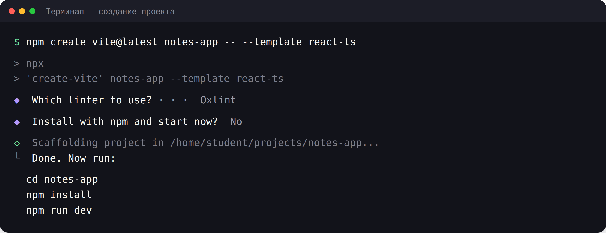
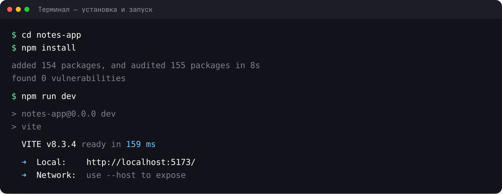
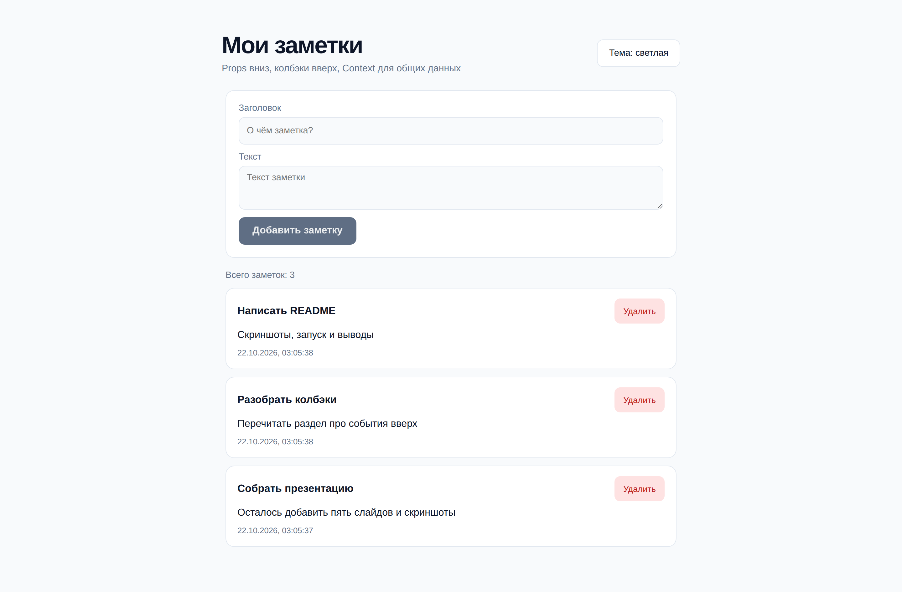
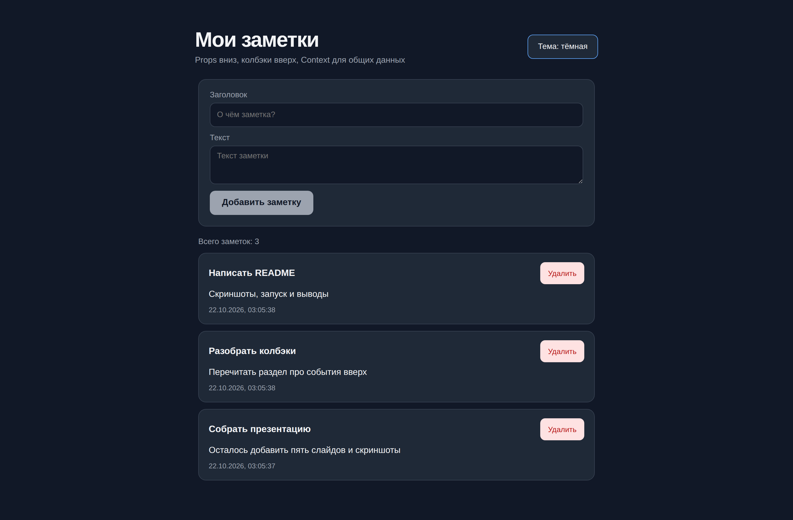
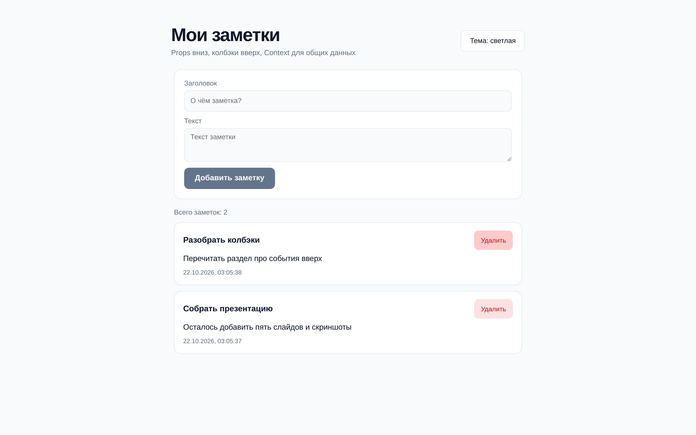
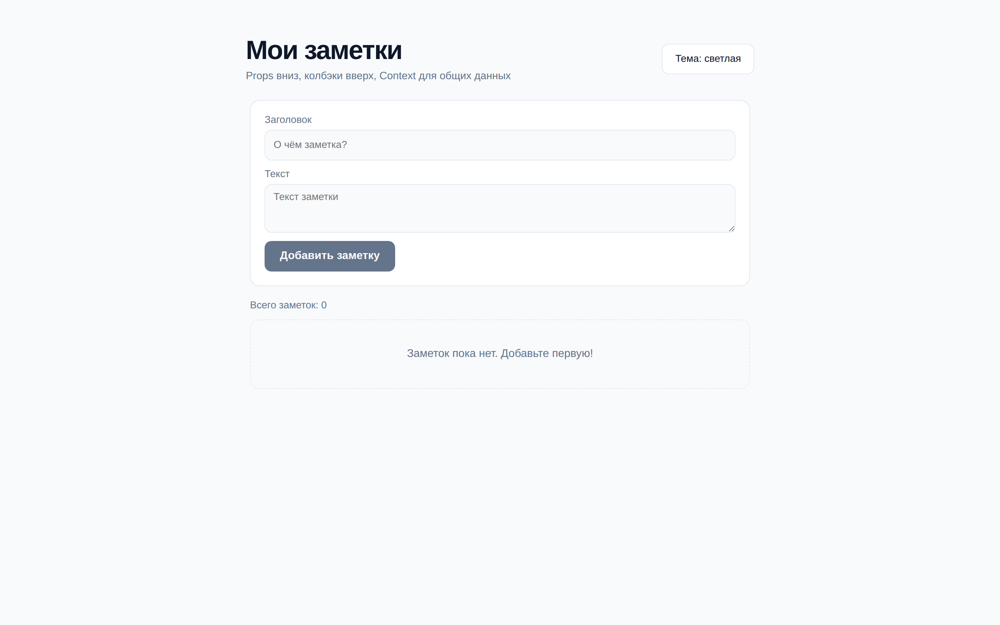
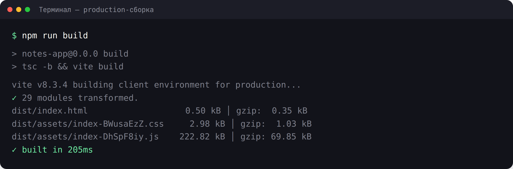

# Практическая работа 18. Взаимодействие между компонентами

### **Тема:** Взаимодействие компонентов: props, колбэки и Context

### **Цель:**
Научиться организовывать обмен данными между компонентами: передавать данные «сверху вниз» через props, сообщать о событиях «снизу вверх» через функции-колбэки, поднимать общее состояние в родителя и передавать данные через Context без «протаскивания» props. Освоить типизацию props, `createContext` и `useContext`.

### **Теоретическая часть:**

**Направление потока данных в React — всегда один: сверху вниз (однонаправленный поток).** Данные передаются от родителя к потомку через props. Если потомку нужно сообщить родителю о событии, он вызывает функцию, которую родитель передал ему тоже через props. Значит:

- **Данные — вниз:** родитель передаёт значения в props.
- **События — вверх:** родитель передаёт функцию-колбэк, потомок её вызывает.
- **Общее состояние — в ближайшего общего родителя** (это называют «подъём состояния», lifting state up).

**1. Данные вниз (props):**
```tsx
interface BadgeProps {
  text: string;
  color?: 'green' | 'red';
}

function Badge({ text, color = 'green' }: BadgeProps) {
  return <span className={`badge badge--${color}`}>{text}</span>;
}

// Родитель
<Badge text="Активен" color="green" />
```

**2. События вверх (колбэк):**
```tsx
interface DeleteButtonProps {
  id: number;
  onDelete: (id: number) => void;
}

function DeleteButton({ id, onDelete }: DeleteButtonProps) {
  return (
    <button type="button" onClick={() => onDelete(id)}>
      Удалить
    </button>
  );
}
```
Потомок **не удаляет** данные сам — он только сообщает о намерении, а решение принимает родитель, который владеет состоянием.

**3. Подъём состояния:**
```tsx
function Parent() {
  const [items, setItems] = useState<Item[]>([]);

  const addItem = (title: string) => {
    setItems((prev) => [...prev, { id: Date.now(), title }]);
  };

  const removeItem = (id: number) => {
    setItems((prev) => prev.filter((item) => item.id !== id));
  };

  return (
    <>
      <ItemForm onAdd={addItem} />
      <ItemList items={items} onRemove={removeItem} />
    </>
  );
}
```
`ItemForm` и `ItemList` не хранят список — им владеет `Parent`. Так оба компонента работают с одними и теми же данными.

**4. `children` и композиция:**
```tsx
interface PanelProps {
  title: string;
  children: ReactNode;
}

function Panel({ title, children }: PanelProps) {
  return (
    <section className="panel">
      <h2>{title}</h2>
      <div className="panel__body">{children}</div>
    </section>
  );
}
```
`children` — это тоже props. Композиция часто удобнее, чем множество отдельных props.

**5. Context — данные для многих компонентов:**
Когда данные нужны сразу нескольким компонентам на разных уровнях, props приходится «протаскивать» через промежуточные компоненты (prop drilling). Context решает эту проблему.

```tsx
import { createContext, useContext, useState } from 'react';
import type { ReactNode } from 'react';

interface ThemeContextValue {
  theme: 'light' | 'dark';
  toggleTheme: () => void;
}

// Значение по умолчанию — null, чтобы хук сообщал об ошибке использования
const ThemeContext = createContext<ThemeContextValue | null>(null);

export function ThemeProvider({ children }: { children: ReactNode }) {
  const [theme, setTheme] = useState<'light' | 'dark'>('light');

  const toggleTheme = () => {
    setTheme((prev) => (prev === 'light' ? 'dark' : 'light'));
  };

  return (
    <ThemeContext.Provider value={{ theme, toggleTheme }}>
      {children}
    </ThemeContext.Provider>
  );
}

// Кастомный хук — безопасный доступ к контексту
export function useTheme(): ThemeContextValue {
  const context = useContext(ThemeContext);

  if (!context) {
    throw new Error('useTheme нужно вызывать внутри ThemeProvider');
  }

  return context;
}
```

**6. Когда использовать Context, а когда props:**
- **props** — данные нужны одному-двум уровням, компонент переиспользуемый и «чистый»;
- **Context** — данные нужны многим компонентам (тема, язык, авторизованный пользователь, настройки), либо глубина вложенности большая;
- Context **не заменяет** управление состоянием: само состояние всё равно живёт в `useState` (или в другой библиотеке), Context только делает его доступным.

**7. Мемоизация значения Provider:**
```tsx
const value = useMemo(() => ({ theme, toggleTheme }), [theme]);
```
Если значение контекста — новый объект при каждом рендере, все потребители будут перерисовываться. `useMemo` стабилизирует ссылку.

**8. Типизация:**
- интерфейс props для каждого компонента;
- `createContext<ValueType | null>(null)` — чтобы TypeScript напоминал о проверке;
- кастомный хук `useX()` скрывает детали контекста и даёт типизированный доступ.

**Правила и антипаттерны:**
- Не изменяйте props внутри компонента — они только для чтения.
- Не храните одно и то же состояние в двух компонентах — поднимите его в общего родителя.
- Не создавайте Context «на всякий случай»: сначала попробуйте props.
- Не передавайте в Context всё приложение целиком — делите по смыслу (тема, уведомления, корзина).

### **Ход работы:**

1. Создать новый React-проект (Vite + TypeScript) командой `npm create vite@latest notes-app -- --template react-ts`
2. Изучить структуру проекта и удалить демо-код шаблона
3. Создать родительский компонент, владеющий состоянием списка
4. Создать форму добавления элемента — событие вверх через колбэк
5. Создать список и карточку элемента — данные вниз через props, удаление через колбэк
6. Поднять состояние в родителя и убедиться, что оба компонента работают с одними данными
7. Создать Context для переключателя темы (или языка) с кастомным хуком
8. Обернуть приложение в Provider и использовать данные в нескольких компонентах на разной глубине
9. Проверить работу в браузере (`npm run dev`)
10. Оформить README.md с описанием работы

### **Пошаговая реализация: заметки со всеми тремя каналами**

Ниже — полный пример, который можно повторить целиком. В результате получится приложение «Мои заметки», в котором работают все три канала взаимодействия:

- **props вниз** — `NoteList` получает массив заметок и передаёт поля одной заметки в `NoteItem`;
- **колбэки вверх** — `NoteForm` вызывает `onAdd`, `NoteItem` вызывает `removeNote`;
- **Context** — `NotesProvider` владеет состоянием и операциями, а `NotesCounter` и `NoteItem` берут данные из контекста без протаскивания props.

Структура проекта к концу работы:

```text
notes-app/
├── public/
├── src/
│   ├── components/
│   │   ├── NoteForm.tsx
│   │   ├── NoteForm.css
│   │   ├── NoteItem.tsx
│   │   ├── NoteItem.css
│   │   ├── NoteList.tsx
│   │   ├── NoteList.css
│   │   ├── NotesCounter.tsx
│   │   ├── NotesCounter.css
│   │   ├── ThemeToggle.tsx
│   │   └── ThemeToggle.css
│   ├── context/
│   │   ├── NotesContext.tsx
│   │   └── ThemeContext.tsx
│   ├── types.ts
│   ├── App.tsx
│   ├── App.css
│   ├── index.css
│   └── main.tsx
├── index.html
├── package.json
├── tsconfig.json
└── vite.config.ts
```

Правило этого примера: **состояние живёт в одном месте** — в `NotesProvider`. Компоненты ниже либо получают данные через props, либо берут их из контекста, либо вызывают колбэки. Никто не хранит массив заметок локально.

---

#### **Шаг 0. Создание и запуск проекта**

```bash
npm create vite@latest notes-app -- --template react-ts
cd notes-app
npm install
npm run dev
```





Откройте `http://localhost:5173/`. Демонстрационный шаблон Vite мы заменим.

---

#### **Шаг 1. Общие типы**

`src/types.ts`:


```ts
export interface Note {
  id: number;
  title: string;
  text: string;
  createdAt: string;
}
```


Общие типы лучше держать в отдельном файле: их импортируют и провайдер, и список, и карточка.

---

#### **Шаг 2. Контекст заметок: владелец состояния**

`src/context/NotesContext.tsx`:


```tsx
import { createContext, useContext, useMemo, useState } from 'react';
import type { ReactNode } from 'react';
import type { Note } from '../types';

interface NotesContextValue {
  notes: Note[];
  addNote: (title: string, text: string) => void;
  removeNote: (id: number) => void;
}

const NotesContext = createContext<NotesContextValue | null>(null);

export function NotesProvider({ children }: { children: ReactNode }) {
  const [notes, setNotes] = useState<Note[]>([]);

  const addNote = (title: string, text: string) => {
    const newNote: Note = {
      id: Date.now(),
      title,
      text,
      createdAt: new Date().toISOString(),
    };

    setNotes((prev) => [newNote, ...prev]);
  };

  const removeNote = (id: number) => {
    setNotes((prev) => prev.filter((note) => note.id !== id));
  };

  const value = useMemo(
    () => ({ notes, addNote, removeNote }),
    [notes],
  );

  return <NotesContext.Provider value={value}>{children}</NotesContext.Provider>;
}

export function useNotes(): NotesContextValue {
  const context = useContext(NotesContext);

  if (!context) {
    throw new Error('useNotes нужно вызывать внутри NotesProvider');
  }

  return context;
}
```


Обратите внимание:

- состояние и операции живут здесь, а не в компонентах;
- `value` обёрнуто в `useMemo` — без него при каждом рендере создавался бы новый объект, и все потребители контекста перерисовывались бы впустую;
- хук `useNotes` проверяет `context === null` и падает с понятной ошибкой, если провайдер отсутствует.

---

#### **Шаг 3. Контекст темы**

`src/context/ThemeContext.tsx`:


```tsx
import { createContext, useContext, useEffect, useMemo, useState } from 'react';
import type { ReactNode } from 'react';

type Theme = 'light' | 'dark';

interface ThemeContextValue {
  theme: Theme;
  toggleTheme: () => void;
}

const ThemeContext = createContext<ThemeContextValue | null>(null);

export function ThemeProvider({ children }: { children: ReactNode }) {
  const [theme, setTheme] = useState<Theme>('light');

  useEffect(() => {
    document.documentElement.dataset.theme = theme;
  }, [theme]);

  const toggleTheme = () => {
    setTheme((prev) => (prev === 'light' ? 'dark' : 'light'));
  };

  const value = useMemo(() => ({ theme, toggleTheme }), [theme]);

  return <ThemeContext.Provider value={value}>{children}</ThemeContext.Provider>;
}

export function useTheme(): ThemeContextValue {
  const context = useContext(ThemeContext);

  if (!context) {
    throw new Error('useTheme нужно вызывать внутри ThemeProvider');
  }

  return context;
}
```


Эффект синхронизирует React-состояние с DOM-атрибутом `data-theme`, а CSS подхватывает его через селектор `:root[data-theme='dark']`.

---

#### **Шаг 4. Форма: событие вверх через колбэк**

`src/components/NoteForm.tsx`:


```tsx
import { useState } from 'react';
import type { FormEvent } from 'react';
import './NoteForm.css';

interface NoteFormProps {
  onAdd: (title: string, text: string) => void;
}

export function NoteForm({ onAdd }: NoteFormProps) {
  const [title, setTitle] = useState('');
  const [text, setText] = useState('');

  const handleSubmit = (event: FormEvent<HTMLFormElement>) => {
    event.preventDefault();

    const trimmedTitle = title.trim();

    if (!trimmedTitle) {
      return;
    }

    onAdd(trimmedTitle, text.trim());
    setTitle('');
    setText('');
  };

  return (
    <form className="note-form" onSubmit={handleSubmit}>
      <label className="note-form__field">
        Заголовок
        <input
          type="text"
          value={title}
          onChange={(event) => setTitle(event.target.value)}
          placeholder="О чём заметка?"
        />
      </label>

      <label className="note-form__field">
        Текст
        <textarea
          value={text}
          onChange={(event) => setText(event.target.value)}
          placeholder="Текст заметки"
          rows={3}
        />
      </label>

      <button type="submit" className="note-form__submit" disabled={!title.trim()}>
        Добавить заметку
      </button>
    </form>
  );
}
```


`src/components/NoteForm.css`:


```css
.note-form {
  display: flex;
  flex-direction: column;
  gap: 12px;
  max-width: 720px;
  margin: 0 auto 20px;
  padding: 20px;
  border: 1px solid var(--border);
  border-radius: 14px;
  background: var(--surface);
}

.note-form__field {
  display: flex;
  flex-direction: column;
  gap: 6px;
  color: var(--muted);
  font-size: 0.9rem;
}

.note-form__field input,
.note-form__field textarea {
  min-height: 44px;
  padding: 10px 12px;
  border: 1px solid var(--border);
  border-radius: 10px;
  background: var(--bg);
  color: var(--text);
  font: inherit;
  outline: none;
}

.note-form__field textarea {
  resize: vertical;
}

.note-form__field input:focus,
.note-form__field textarea:focus {
  border-color: var(--primary);
  box-shadow: 0 0 0 3px rgba(37, 99, 235, 0.15);
}

.note-form__submit {
  align-self: flex-start;
  min-height: 44px;
  padding: 10px 22px;
  border: none;
  border-radius: 10px;
  background: var(--primary);
  color: #fff;
  font-weight: 600;
  cursor: pointer;
  transition: background 0.2s ease;
}

.note-form__submit:hover {
  filter: brightness(0.95);
}

.note-form__submit:disabled {
  background: var(--muted);
  color: var(--bg);
  cursor: not-allowed;
}
```


Форма не знает, где хранятся заметки и куда они попадут. Она собирает значения, валидирует заголовок и сообщает наружу: `onAdd(title, text)`.

---

#### **Шаг 5. Карточка заметки: данные вниз, удаление вверх**

`src/components/NoteItem.tsx`:


```tsx
import { useNotes } from '../context/NotesContext';
import './NoteItem.css';

interface NoteItemProps {
  id: number;
  title: string;
  text: string;
  createdAt: string;
}

export function NoteItem({ id, title, text, createdAt }: NoteItemProps) {
  const { removeNote } = useNotes();

  return (
    <article className="note">
      <header className="note__header">
        <h3 className="note__title">{title}</h3>

        <button
          type="button"
          className="note__delete"
          onClick={() => removeNote(id)}
          aria-label={`Удалить заметку «${title}»`}
        >
          Удалить
        </button>
      </header>

      {text && <p className="note__text">{text}</p>}

      <time className="note__date" dateTime={createdAt}>
        {new Date(createdAt).toLocaleString('ru-RU')}
      </time>
    </article>
  );
}
```


`src/components/NoteItem.css`:


```css
.note {
  padding: 16px 18px;
  border: 1px solid var(--border);
  border-radius: 14px;
  background: var(--surface);
}

.note__header {
  display: flex;
  align-items: center;
  justify-content: space-between;
  gap: 12px;
}

.note__title {
  margin: 0;
  color: var(--text);
  font-size: 1.05rem;
}

.note__delete {
  min-height: 40px;
  padding: 8px 14px;
  border: none;
  border-radius: 9px;
  background: #fee2e2;
  color: #b91c1c;
  font: inherit;
  font-size: 0.85rem;
  cursor: pointer;
  transition: background 0.2s ease;
}

.note__delete:hover {
  background: #fecaca;
}

.note__text {
  margin: 10px 0;
  color: var(--text);
}

.note__date {
  color: var(--muted);
  font-size: 0.8rem;
}
```


Данные для отображения приходят через props (`id`, `title`, `text`, `createdAt`). Для удаления карточка вызывает `removeNote` из контекста — это тоже «событие вверх», но без длинной цепочки props через промежуточные уровни.

---

#### **Шаг 6. Список: props вниз**

`src/components/NoteList.tsx`:


```tsx
import type { Note } from '../types';
import { NoteItem } from './NoteItem';
import './NoteList.css';

interface NoteListProps {
  notes: Note[];
}

export function NoteList({ notes }: NoteListProps) {
  if (notes.length === 0) {
    return <p className="notes__empty">Заметок пока нет. Добавьте первую!</p>;
  }

  return (
    <div className="notes__list">
      {notes.map((note) => (
        <NoteItem
          key={note.id}
          id={note.id}
          title={note.title}
          text={note.text}
          createdAt={note.createdAt}
        />
      ))}
    </div>
  );
}
```


`src/components/NoteList.css`:


```css
.notes__empty {
  max-width: 720px;
  margin: 0 auto;
  padding: 40px 24px;
  border: 1px dashed var(--border);
  border-radius: 14px;
  color: var(--muted);
  text-align: center;
}

.notes__list {
  display: grid;
  gap: 12px;
  max-width: 720px;
  margin: 0 auto;
}
```


Список получает только массив — и не берёт его из контекста. Так проще увидеть разницу: «чистый» переиспользуемый компонент принимает данные через props.

---

#### **Шаг 7. Счётчик: данные из Context на другом уровне**

`src/components/NotesCounter.tsx`:


```tsx
import { useNotes } from '../context/NotesContext';
import './NotesCounter.css';

export function NotesCounter() {
  const { notes } = useNotes();

  return <p className="notes__counter">Всего заметок: {notes.length}</p>;
}
```


`src/components/NotesCounter.css`:


```css
.notes__counter {
  max-width: 720px;
  margin: 0 auto 12px;
  color: var(--muted);
  font-size: 0.9rem;
}
```


`NotesCounter` никакого отношения к форме и списку не имеет — но он обновляется вместе с ними, потому что читает то же состояние из контекста.

---

#### **Шаг 8. Переключатель темы**

`src/components/ThemeToggle.tsx`:


```tsx
import { useTheme } from '../context/ThemeContext';
import './ThemeToggle.css';

export function ThemeToggle() {
  const { theme, toggleTheme } = useTheme();

  return (
    <button type="button" className="theme-toggle" onClick={toggleTheme}>
      Тема: {theme === 'light' ? 'светлая' : 'тёмная'}
    </button>
  );
}
```


`src/components/ThemeToggle.css`:


```css
.theme-toggle {
  min-height: 44px;
  padding: 10px 18px;
  border: 1px solid var(--border);
  border-radius: 10px;
  background: var(--surface);
  color: var(--text);
  font: inherit;
  font-size: 0.9rem;
  cursor: pointer;
  transition: background 0.2s ease, border-color 0.2s ease;
}

.theme-toggle:hover {
  border-color: var(--primary);
}
```


---

#### **Шаг 9. Сборка страницы**

`src/App.tsx`:


```tsx
import './App.css';
import { NotesProvider, useNotes } from './context/NotesContext';
import { ThemeProvider } from './context/ThemeContext';
import { NoteForm } from './components/NoteForm';
import { NoteList } from './components/NoteList';
import { NotesCounter } from './components/NotesCounter';
import { ThemeToggle } from './components/ThemeToggle';

function NotesPage() {
  const { notes, addNote } = useNotes();

  return (
    <main className="app">
      <header className="app__header">
        <div className="app__heading">
          <h1>Мои заметки</h1>
          <p>Props вниз, колбэки вверх, Context для общих данных</p>
        </div>
        <ThemeToggle />
      </header>

      <NoteForm onAdd={addNote} />
      <NotesCounter />
      <NoteList notes={notes} />
    </main>
  );
}

function App() {
  return (
    <ThemeProvider>
      <NotesProvider>
        <NotesPage />
      </NotesProvider>
    </ThemeProvider>
  );
}

export default App;
```


`src/App.css`:


```css
.app {
  width: 100%;
  max-width: 780px;
  margin: 0 auto;
  padding: 52px 24px 72px;
}

.app__header {
  display: flex;
  align-items: center;
  justify-content: space-between;
  gap: 12px;
  flex-wrap: wrap;
  margin-bottom: 26px;
}

.app__heading h1 {
  margin: 0 0 6px;
  color: var(--text);
  font-size: 38px;
  letter-spacing: -1.2px;
}

.app__heading p {
  margin: 0;
  color: var(--muted);
  font-size: 0.95rem;
}
```


`src/index.css`:


```css
:root {
  --bg: #f8fafc;
  --surface: #ffffff;
  --text: #0f172a;
  --muted: #64748b;
  --border: #e2e8f0;
  --primary: #2563eb;
}

:root[data-theme='dark'] {
  --bg: #111827;
  --surface: #1f2937;
  --text: #f3f4f6;
  --muted: #9ca3af;
  --border: #374151;
  --primary: #60a5fa;
}

* {
  box-sizing: border-box;
}

html {
  min-width: 320px;
  background: var(--bg);
}

body {
  margin: 0;
  min-width: 320px;
  min-height: 100vh;
  background: var(--bg);
  color: var(--text);
  font-family: 'Segoe UI', Tahoma, Geneva, Verdana, sans-serif;
  -webkit-font-smoothing: antialiased;
  transition: background 0.25s ease, color 0.25s ease;
}

button,
input,
select,
textarea {
  font: inherit;
}
```


`src/main.tsx`:


```tsx
import { StrictMode } from 'react';
import { createRoot } from 'react-dom/client';
import './index.css';
import App from './App';

createRoot(document.getElementById('root')!).render(
  <StrictMode>
    <App />
  </StrictMode>,
);
```


Добавьте три заметки через форму — счётчик обновится, список перестроится:



---

#### **Шаг 10. Проверка сценариев**

**Тема.** Нажмите «Тема: светлая» — весь интерфейс переключается на тёмную палитру. Значение лежит в одном контексте, а используют его и заголовок, и форма, и карточки:



**Удаление.** Нажмите «Удалить» у первой заметки — она исчезнет, счётчик станет `2`. Сама карточка массив не меняет: она вызывает `removeNote`, а состояние принадлежит провайдеру:



**Пустое состояние.** Удалите оставшиеся заметки — вместо списка появится заглушка, а счётчик покажет `0`:



---

#### **Шаг 11. Production-сборка**

```bash
npm run build
```



Сборка должна завершиться без ошибок TypeScript.

---

#### **Как здесь работают три канала**

- **props вниз:** `NoteList` получает `notes` от `NotesPage` и рендерит `NoteId`-карточки с объектными props; `NoteForm` получает только функцию `onAdd`.
- **колбэки вверх:** форму заполняет пользователь — `NoteForm` сообщает `onAdd(title, text)`; карточка сообщает `removeNote(id)`. Внутри этих функций все изменения выполняет владелец состояния.
- **Context без prop drilling:** `NotesCounter` и `NoteItem` читают данные на разных уровнях, не получая их через промежуточные компоненты; `ThemeToggle` и страницы используют один и тот же `ThemeContext`.
- **Один владелец состояния:** оба контекста хранят `useState` внутри своих `Provider`-ов. Context — это «канал доставки», а не хранилище.

---

#### **Частые ошибки**

| Ошибка | Причина | Решение |
|--------|---------|---------|
| `useNotes is not a function` | Хук импортирован не из файла, где вызывается `createContext` | Импорт из `NotesContext.tsx` |
| Ошибка «используйте внутри Provider» | Компонент рендерится вне `NotesProvider` | Проверить обёртку `<NotesProvider>` вокруг `App` |
| Потребители перерисовываются постоянно | `value={{ notes, addNote }}` создаёт новый объект каждый рендер | Обернуть значение в `useMemo` |
| Список не обновляется после удаления | Массив мутирован или используется неверное `id` | Фильтровать через `filter()`; передавать стабильный `id` |
| Тема не применяется | CSS селектор не совпадает с атрибутом | Проверить `document.documentElement.dataset.theme` и `:root[data-theme='dark']` |
| Все карточки получают одинаковые данные | Внутри `map()` передаются не per-item props, а общие значения | Передавать `note.id`, `note.title` и т.д. |
| Двойные изменения состояния | Один и тот же массив хранится в двух компонентах | Поднять состояние в единого владельца |

---

#### **Чек-лист перед сдачей**

- [ ] проект запускается командой `npm run dev`;
- [ ] `npm run build` проходит без ошибок TypeScript;
- [ ] есть минимум одна пара «props вниз / колбэк вверх»;
- [ ] состояние списка живёт в одном компоненте (провайдере или родителе);
- [ ] есть Context с двумя провайдерами и кастомными хуками;
- [ ] значение провайдера обёрнуто в `useMemo`;
- [ ] есть компонент на «другом уровне», читающий контекст;
- [ ] работает переключение темы и удаление заметок;
- [ ] в README описаны все три канала и есть скриншоты.

---

---

## **Варианты заданий:**

### **Вариант 1: Система управления задачами**
Создайте систему с компонентами:
- Список задач с фильтрами
- Форма создания и редактирования задачи
- Детали задачи (модальное окно)
- Статистика выполнения

Взаимодействие: props вниз, колбэки вверх, общее состояние у родителя.

### **Вариант 2: Интернет-магазин**
Создайте магазин с компонентами:
- Каталог товаров
- Корзина покупок (Context для доступа из шапки и каталога)
- Фильтры и сортировка
- Детали товара

### **Вариант 3: Система бронирования**
Создайте систему бронирования:
- Календарь доступности
- Форма бронирования
- Список бронирований
- Подтверждение брони

### **Вариант 4: Чат-приложение**
Создайте чат:
- Список контактов
- Окно чата
- Форма отправки сообщения
- Информация о выбранном пользователе (Context для выбранного контакта)

### **Вариант 5: Дашборд аналитики**
Создайте дашборд:
- Виджеты статистики
- Фильтры данных (общие для всех виджетов — Context)
- Детальные отчёты
- Настройки виджетов

### **Вариант 6: Система документооборота**
Создайте систему:
- Список документов
- Редактор документа
- История изменений
- Комментарии

### **Вариант 7: Планировщик мероприятий**
Создайте планировщик:
- Календарь событий
- Форма создания события
- Список участников
- Уведомления

### **Вариант 8: Система тестирования**
Создайте систему тестов:
- Список тестов
- Прохождение теста
- Результаты
- Статистика (Context для текущей сессии)

### **Вариант 9: Файловый менеджер**
Создайте менеджер:
- Дерево папок
- Список файлов
- Предпросмотр
- Операции с файлами (копирование/удаление через колбэки)

### **Вариант 10: Система уведомлений**
Создайте систему:
- Список уведомлений
- Настройки оповещений
- История уведомлений
- Шаблоны сообщений

### **Вариант 11: CRM-система**
Создайте CRM:
- Список клиентов
- Карточка клиента
- История взаимодействий
- Напоминания

### **Вариант 12: Социальная сеть**
Создайте соцсеть:
- Лента постов
- Профиль пользователя (Context с данными текущего пользователя)
- Комментарии
- Лайки

### **Вариант 13: Система голосования**
Создайте систему:
- Список опросов
- Форма голосования
- Результаты
- Статистика

### **Вариант 14: Игровая платформа**
Создайте платформу:
- Список игр
- Игровой процесс
- Рейтинги
- Профиль игрока (Context для счёта и достижений)

### **Вариант 15: Образовательная платформа**
Создайте платформу:
- Курсы и уроки
- Прогресс обучения (Context, доступный из шапки и списка уроков)
- Тесты и задания
- Сертификаты

---

## **Критерии оценки:**

### **5 (Отлично):**
- Полностью реализованы все виды взаимодействия согласно варианту
- Данные передаются вниз через props, события — вверх через колбэки
- Общее состояние поднято в ближайшего общего родителя
- Context применён обоснованно, есть кастомный хук доступа и проверка на отсутствие Provider
- Все props и значение контекста типизированы
- Нет дублирования состояния и лишнего prop drilling
- Качественная стилизация и адаптивность, обработка пустых состояний
- Полное описание архитектуры в README.md

### **4 (Хорошо):**
- Основные виды взаимодействия реализованы
- Props и колбэки применены правильно
- Context используется, но есть незначительные недочёты (например, нет проверки Provider)
- Типизация присутствует частично
- README.md содержит основную информацию

### **3 (Удовлетворительно):**
- Частичная реализация взаимодействия
- Есть ошибки в передаче данных или событий
- Context применён без необходимости либо не используется там, где нужен
- Архитектура требует улучшений
- README.md оформлен неполностью

### **2 (Неудовлетворительно):**
- Взаимодействие между компонентами не работает
- Состояние мутируется или дублируется в нескольких компонентах
- Критические ошибки архитектуры
- README.md отсутствует

---

## **Контрольные вопросы:**

1. В каком направлении передаются данные в React и почему поток называют однонаправленным?
2. Чем props отличаются от state?
3. Почему props нельзя изменять внутри компонента?
4. Как компонент-потомок может сообщить родителю о событии?
5. Что такое подъём состояния (lifting state up) и зачем он нужен?
6. Почему опасно хранить одно и то же состояние в двух компонентах?
7. Что такое prop drilling и какие у него минусы?
8. Какую проблему решает Context?
9. Из каких частей состоит работа с Context (`createContext`, `Provider`, `useContext`)?
10. Зачем проверять результат `useContext` на `null` внутри кастомного хука?
11. Почему значение Provider стоит мемоизировать через `useMemo`?
12. Что такое `children` и в чём преимущество композиции перед множеством props?
13. Когда достаточно props, а когда стоит переходить на Context?
14. Можно ли использовать несколько разных Context в одном приложении? Приведите пример.
15. Как типизировать значение контекста и props компонента?

---

## **Файловая структура проекта:**

```
practical-work-18-component-communication/
│
├── assets/
│   └── images/                     # Скриншоты для README
├── public/                         # Статические файлы приложения
├── src/
│   ├── assets/                     # Ресурсы, импортируемые в код
│   ├── components/
│   │   ├── NoteForm.tsx            # Форма: событие вверх через колбэк
│   │   ├── NoteForm.css            # Стили формы
│   │   ├── NoteItem.tsx            # Карточка: данные вниз, удаление через Context
│   │   ├── NoteItem.css            # Стили карточки
│   │   ├── NoteList.tsx            # Список через props
│   │   ├── NoteList.css            # Стили списка и пустого состояния
│   │   ├── NotesCounter.tsx        # Данные из Context
│   │   ├── NotesCounter.css        # Стили счётчика
│   │   ├── ThemeToggle.tsx         # Переключатель темы из Context
│   │   └── ThemeToggle.css         # Стили переключателя
│   ├── context/
│   │   ├── NotesContext.tsx        # Состояние заметок и операции
│   │   └── ThemeContext.tsx        # Тема приложения
│   ├── types.ts                    # Общие типы
│   ├── App.css
│   ├── App.tsx
│   ├── index.css
│   └── main.tsx
│
├── .gitignore
├── .oxlintrc.json                  # Настройки линтера oxlint
├── index.html
├── package.json
├── tsconfig.json
├── tsconfig.app.json
├── tsconfig.node.json
└── vite.config.ts
```

---

## **Пример README.md для варианта 12 (Социальная сеть):**

```markdown
# Практическая работа 18. Взаимодействие между компонентами

## Вариант 12: Социальная сеть

### Задание:
Создать мини-соцсеть с лентой постов, профилем, комментариями и лайками.
Показать разные способы взаимодействия компонентов.

### Реализованные виды взаимодействия:
- **props вниз** — передача постов и пользователя в дочерние компоненты
- **колбэки вверх** — добавление поста, лайк, удаление комментария
- **подъём состояния** — лента и комментарии хранятся у общего родителя
- **Context** — данные текущего пользователя и тема доступны из шапки и ленты

### Структура компонентов:
- `App` — провайдеры и общий layout
- `PostList` / `PostCard` — лента постов
- `CommentList` / `CommentForm` — комментарии
- `UserContext` — текущий пользователь
- `ThemeContext` — переключение темы

### Скриншоты:


### Запуск проекта:
```bash
npm install
npm run dev
```

Приложение доступно по адресу: `http://localhost:5173`

### Проверка:
```bash
npm run build
npm run lint
```
```

---

## **Инструкция по сдаче работы:**

1. Создать репозиторий на Gogs (http://192.168.4.90/)
2. Клонировать репозиторий локально
3. Создать React-проект в папке репозитория:
   ```bash
   npm create vite@latest . -- --template react-ts
   npm install
   ```
4. Реализовать взаимодействие компонентов согласно варианту (props, колбэки, Context)
5. Убедиться, что общее состояние не дублируется, а Context используется обоснованно
6. Сделать коммиты с понятными сообщениями
7. Добавить скриншоты работы в папку `assets/images`
8. Оформить README.md с описанием архитектуры взаимодействия
9. Запушить изменения в Gogs
10. Предоставить ссылку на репозиторий преподавателю
