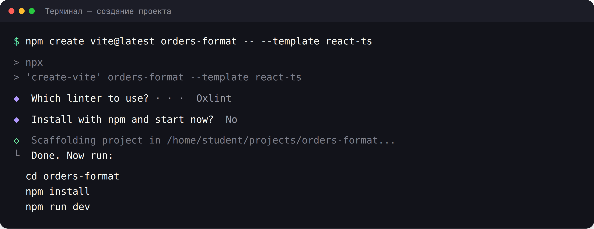
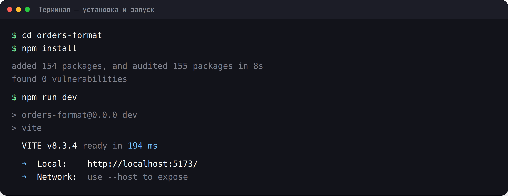
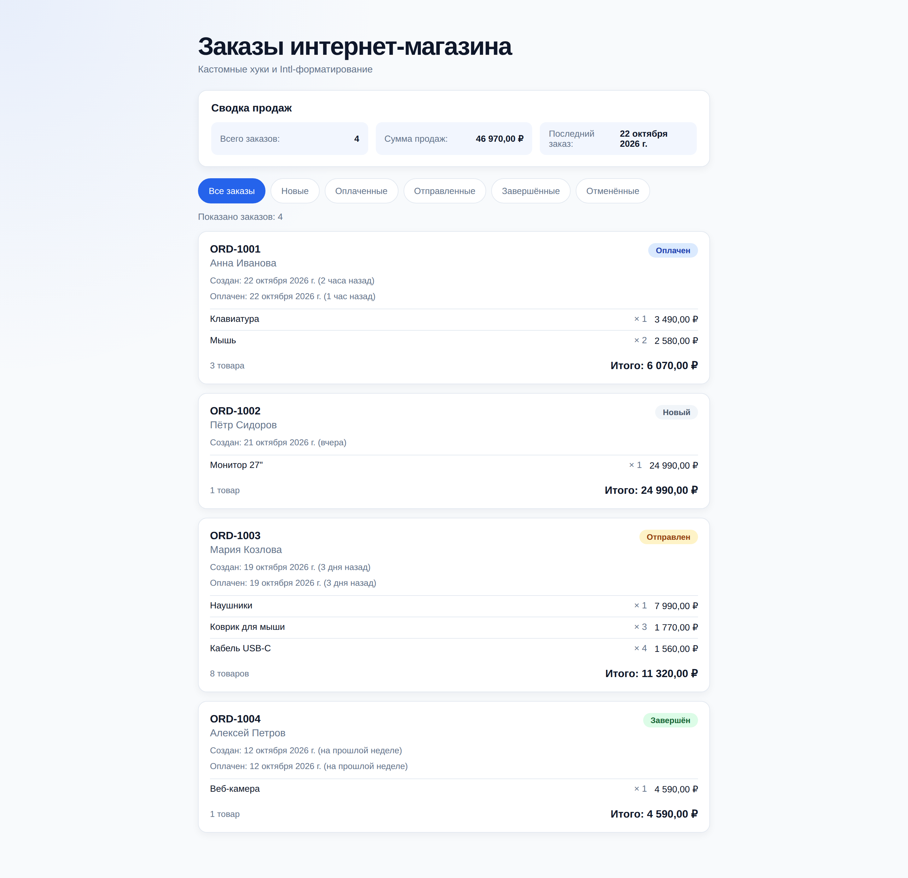
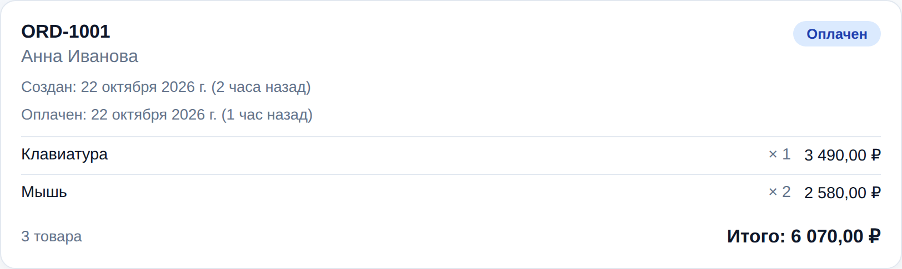
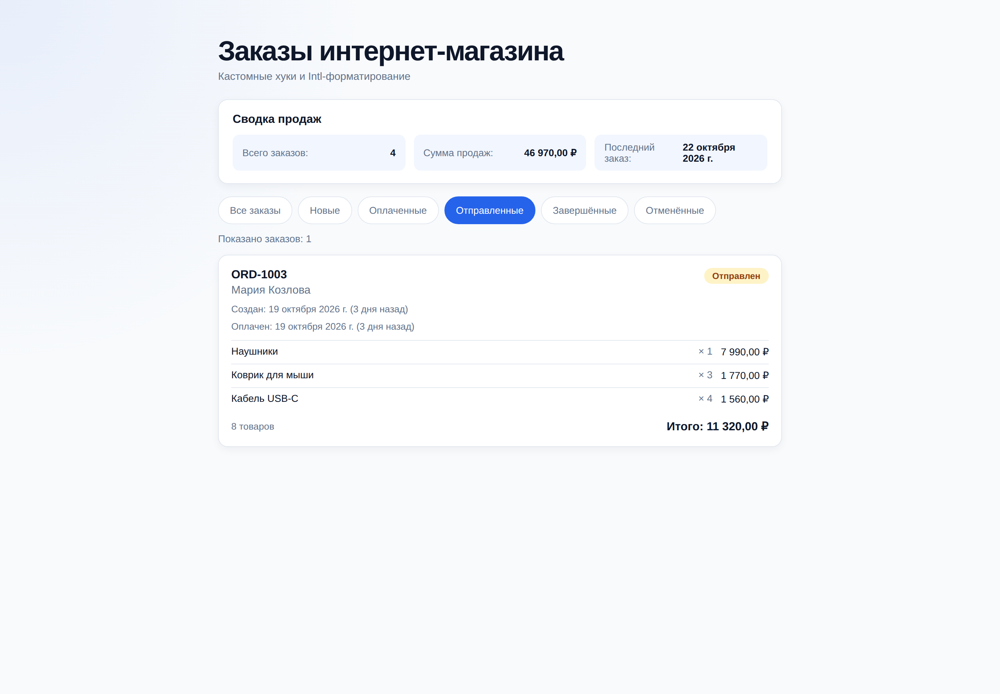
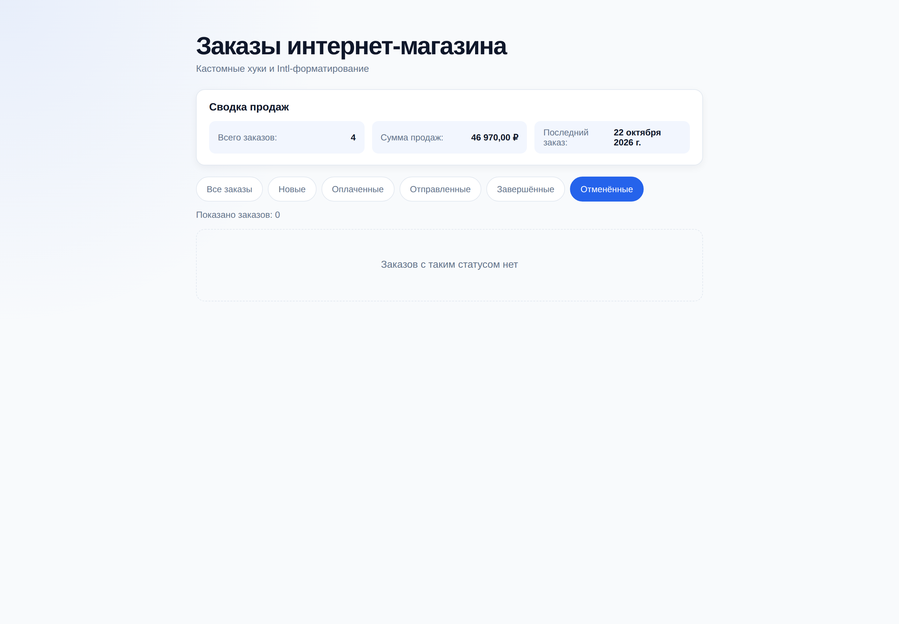
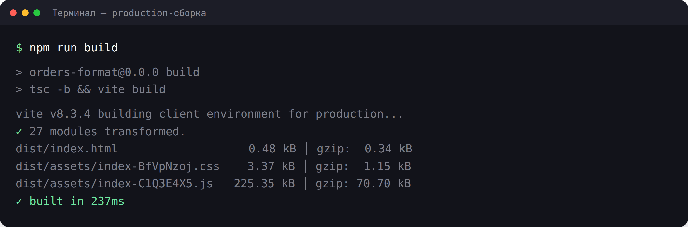

# Практическая работа 19. Форматирование данных и кастомные хуки

### **Тема:** Кастомные хуки и форматирование данных через `Intl`

### **Цель:**
Научиться выносить повторяющуюся логику в собственные хуки и форматировать данные для отображения пользователю. Освоить правила создания кастомных хуков, хуки `useLocalStorage` и `useFetch`, а также встроенный объект `Intl`: `Intl.NumberFormat`, `Intl.DateTimeFormat`, `Intl.RelativeTimeFormat`, `Intl.PluralRules`.

### **Теоретическая часть:**

**Кастомный хук** — это обычная функция, имя которой начинается с `use` и которая внутри вызывает другие хуки. Кастомные хуки позволяют переиспользовать логику состояния и эффектов между компонентами, при этом каждый вызов хука создаёт **своё независимое** состояние.

**1. Правила кастомных хуков:**
- имя начинается с `use` (`useLocalStorage`, `useFetch`, `useCounter`);
- вызывать кастомный хук можно только на верхнем уровне компонента или другого хука;
- внутри можно использовать любые встроенные хуки;
- хук может принимать параметры и возвращать значение любого типа — число, объект, массив, функцию;
- кастомный хук **не является** общим состоянием: два вызова `useLocalStorage('a')` и `useLocalStorage('b')` независимы.

**2. Пример простого кастомного хука:**
```tsx
import { useState } from 'react';

export function useToggle(initialValue = false) {
  const [value, setValue] = useState(initialValue);

  const toggle = () => setValue((prev) => !prev);
  const setOn = () => setValue(true);
  const setOff = () => setValue(false);

  return { value, toggle, setOn, setOff };
}
```

**3. `useLocalStorage` — состояние, сохраняемое между перезагрузками:**
```tsx
import { useEffect, useState } from 'react';

export function useLocalStorage<T>(key: string, initialValue: T) {
  const [value, setValue] = useState<T>(() => {
    try {
      const saved = window.localStorage.getItem(key);
      return saved ? (JSON.parse(saved) as T) : initialValue;
    } catch {
      return initialValue;
    }
  });

  useEffect(() => {
    try {
      window.localStorage.setItem(key, JSON.stringify(value));
    } catch {
      // Запись может быть недоступна (приватный режим, переполнение) — молча игнорируем
    }
  }, [key, value]);

  return [value, setValue] as const;
}
```
Обратите внимание на `as const` — благодаря ему TypeScript выводит кортеж `[T, Dispatch<SetStateAction<T>>]`, как у `useState`.

**4. `useFetch` — загрузка данных с обработкой состояний:**
```tsx
import { useEffect, useState } from 'react';

interface FetchState<T> {
  data: T | null;
  isLoading: boolean;
  error: string | null;
}

export function useFetch<T>(url: string): FetchState<T> {
  const [state, setState] = useState<FetchState<T>>({
    data: null,
    isLoading: true,
    error: null,
  });

  useEffect(() => {
    const controller = new AbortController();

    const load = async () => {
      setState({ data: null, isLoading: true, error: null });

      try {
        const response = await fetch(url, { signal: controller.signal });

        if (!response.ok) {
          throw new Error(`Ошибка запроса: ${response.status}`);
        }

        const data = (await response.json()) as T;
        setState({ data, isLoading: false, error: null });
      } catch (error) {
        if (error instanceof DOMException && error.name === 'AbortError') {
          return;
        }

        setState({
          data: null,
          isLoading: false,
          error: 'Не удалось загрузить данные',
        });
      }
    };

    void load();

    return () => controller.abort();
  }, [url]);

  return state;
}
```
`AbortController` отменяет запрос при размонтировании или смене `url` — это защита от гонок и «утечек».

**5. Форматирование через `Intl`:**
Встроенный объект `Intl` умеет форматировать данные по правилам локали без сторонних библиотек.

**Валюта и числа — `Intl.NumberFormat`:**
```ts
const currencyFormatter = new Intl.NumberFormat('ru-RU', {
  style: 'currency',
  currency: 'RUB',
  maximumFractionDigits: 2,
});

currencyFormatter.format(1234567.5); // 1 234 567,50 ₽
```

**Даты — `Intl.DateTimeFormat`:**
```ts
const dateFormatter = new Intl.DateTimeFormat('ru-RU', {
  day: '2-digit',
  month: 'long',
  year: 'numeric',
});

dateFormatter.format(new Date('2026-03-14')); // 14 марта 2026 г.
```

**Относительное время — `Intl.RelativeTimeFormat`:**
```ts
const relativeFormatter = new Intl.RelativeTimeFormat('ru-RU', { numeric: 'auto' });

relativeFormatter.format(-5, 'minute'); // 5 минут назад
relativeFormatter.format(2, 'day');     // послезавтра
```

**Склонения — `Intl.PluralRules`:**
```ts
const pluralRules = new Intl.PluralRules('ru-RU');

pluralRules.select(1); // one
pluralRules.select(3); // few
pluralRules.select(5); // many
```

**6. Создание форматтеров — дорогая операция.**
`new Intl.NumberFormat(...)` стоит недёшево, поэтому:
- создавайте форматтер **один раз** на уровне модуля и переиспользуйте функцию;
- если параметры форматтера зависят от props или локали — кэшируйте через `useMemo`:
```tsx
const priceFormatter = useMemo(
  () => new Intl.NumberFormat('ru-RU', { style: 'currency', currency }),
  [currency],
);
```

**7. Форматирование — это вычисление, а не состояние.**
Не храните отформатированные строки в состоянии: результат всегда можно получить во время рендера из «сырых» данных. Храните исходные числа и даты, а форматируйте при отображении.

**Правила и антипаттерны:**
- Не создавайте кастомные хуки ради «красоты» — выносите только повторяющуюся логику.
- Не смешивайте в одном хуке несвязанные задачи (загрузку и форматирование, например).
- Не забывайте про cleanup в хуках с эффектами.
- Не храните в состоянии производные значения (суммы, отформатированные строки).

### **Ход работы:**

1. Создать новый React-проект (Vite + TypeScript) командой `npm create vite@latest orders-format -- --template react-ts`
2. Изучить структуру проекта и удалить демо-код шаблона
3. Написать кастомный хук `useLocalStorage` и применить его для сохранения фильтра
4. Написать утилиты форматирования в `src/utils/format.ts` на основе `Intl`
5. Реализовать форматирование цен в рублях через `Intl.NumberFormat`
6. Реализовать форматирование дат через `Intl.DateTimeFormat` и относительного времени через `Intl.RelativeTimeFormat`
7. Реализовать правильные склонения («1 товар», «2 товара», «5 товаров») через `Intl.PluralRules`
8. Показать карточки заказов с рассчитанной суммой и отформатированными данными
9. Проверить работу в браузере (`npm run dev`) и сборку (`npm run build`)
10. Оформить README.md с описанием работы

### **Пошаговая реализация: заказы с хуками и Intl-форматированием**

Ниже — полный пример, который можно повторить целиком. В результате получится список заказов интернет-магазина, в котором работают два кастомных хука:

- **`useLocalStorage`** — обёртка над `useState` + `useEffect`: сохраняет выбранный фильтр между перезагрузками страницы;
- **`useFormatters`** — возвращает функции форматирования, пересоздавая их только при смене локали (`useMemo`);
- **`utils/format.ts`** — «чистое» форматирование без React: валюты, даты, «2 часа назад» и склонение «1 товар / 2 товара / 5 товаров».

Структура проекта к концу работы:

```text
orders-format/
├── public/
├── src/
│   ├── components/
│   │   ├── OrderCard.tsx
│   │   ├── OrderCard.css
│   │   ├── OrderList.tsx
│   │   ├── OrderList.css
│   │   ├── SalesSummary.tsx
│   │   └── SalesSummary.css
│   ├── data/
│   │   └── orders.ts
│   ├── hooks/
│   │   ├── useLocalStorage.ts
│   │   └── useFormatters.ts
│   ├── utils/
│   │   └── format.ts
│   ├── App.tsx
│   ├── App.css
│   ├── index.css
│   └── main.tsx
├── index.html
├── package.json
├── tsconfig.json
└── vite.config.ts
```

Правило этого примера: **форматирование — не состояние.** Суммы, даты и «2 часа назад» считаются на лету во время рендера; в состоянии живут только исходные данные и выбранный фильтр.

---

#### **Шаг 0. Создание и запуск проекта**

```bash
npm create vite@latest orders-format -- --template react-ts
cd orders-format
npm install
npm run dev
```





Откройте `http://localhost:5173/`. Демонстрационный шаблон Vite мы заменим.

---

#### **Шаг 1. Утилиты форматирования на `Intl`**

Сначала пишем обычные функции — они не зависят от React. `src/utils/format.ts`:


```ts
const currencyFormatters = new Map<string, Intl.NumberFormat>();

export function formatCurrency(value: number, currency = 'RUB'): string {
  let formatter = currencyFormatters.get(currency);

  if (!formatter) {
    formatter = new Intl.NumberFormat('ru-RU', {
      style: 'currency',
      currency,
      maximumFractionDigits: 2,
    });

    currencyFormatters.set(currency, formatter);
  }

  return formatter.format(value);
}

const dateFormatter = new Intl.DateTimeFormat('ru-RU', {
  day: '2-digit',
  month: 'long',
  year: 'numeric',
});

export function formatDate(value: string | Date): string {
  return dateFormatter.format(new Date(value));
}

const relativeFormatter = new Intl.RelativeTimeFormat('ru-RU', { numeric: 'auto' });

const TIME_UNITS: { unit: Intl.RelativeTimeFormatUnit; seconds: number }[] = [
  { unit: 'year', seconds: 60 * 60 * 24 * 365 },
  { unit: 'month', seconds: 60 * 60 * 24 * 30 },
  { unit: 'week', seconds: 60 * 60 * 24 * 7 },
  { unit: 'day', seconds: 60 * 60 * 24 },
  { unit: 'hour', seconds: 60 * 60 },
  { unit: 'minute', seconds: 60 },
  { unit: 'second', seconds: 1 },
];

export function formatRelativeTime(value: string | Date): string {
  const diffSeconds = Math.round((new Date(value).getTime() - Date.now()) / 1000);

  for (const { unit, seconds } of TIME_UNITS) {
    if (Math.abs(diffSeconds) >= seconds) {
      return relativeFormatter.format(Math.round(diffSeconds / seconds), unit);
    }
  }

  return relativeFormatter.format(0, 'second');
}

const pluralRules = new Intl.PluralRules('ru-RU');

type PluralForm = 'one' | 'few' | 'many' | 'other';

const GOODS_FORMS: Record<PluralForm, string> = {
  one: 'товар',
  few: 'товара',
  many: 'товаров',
  other: 'товара',
};

export function formatGoodsCount(count: number): string {
  const form = pluralRules.select(count) as PluralForm;

  return `${count} ${GOODS_FORMS[form] ?? GOODS_FORMS.other}`;
}
```


Что здесь важно:

- **Кэш форматтеров.** `Intl.NumberFormat` — дорогой объект, поэтому экземпляры складываются в `Map` на уровне модуля и создаются один раз, а не на каждом рендере;
- **`Intl.RelativeTimeFormat`** с опцией `numeric: 'auto'` даёт живой текст: не «2 дня назад» для позавчерашней даты, а «вчера», «3 дня назад»;
- **`Intl.PluralRules.select()`** возвращает для русского языка формы `one` / `few` / `many` — по ним и выбирается «1 товар», «2 товара», «5 товаров». Писать `count === 1 ? 'товар' : 'товаров'` руками не нужно: правила склонения знает локаль, а не разработчик.

---

#### **Шаг 2. Кастомный хук `useLocalStorage`**

Кастомный хук — это обычная функция, которая внутри вызывает встроенные хуки и начинается со слова `use`. `src/hooks/useLocalStorage.ts`:


```ts
import { useEffect, useState } from 'react';

export function useLocalStorage<T>(key: string, initialValue: T) {
  const [value, setValue] = useState<T>(() => {
    try {
      const saved = window.localStorage.getItem(key);
      return saved ? (JSON.parse(saved) as T) : initialValue;
    } catch {
      return initialValue;
    }
  });

  useEffect(() => {
    try {
      window.localStorage.setItem(key, JSON.stringify(value));
    } catch {
      // Игнорируем ошибки записи в localStorage
    }
  }, [key, value]);

  return [value, setValue] as const;
}
```


Обратите внимание:

- **Ленивый инициализатор.** `useState(() => ...)` читает `localStorage` один раз, при первом рендере, а не на каждом;
- **Синхронизация записи** в `useEffect` с зависимостями `[key, value]`: значение изменилось — записали;
- **`try/catch`** по обеим сторонам: чтение может упасть (битый JSON), запись может быть запрещена (режим инкогнито, переполнение квоты) — приложение не должно ломаться;
- возвращаем `as const` — TypeScript поймёт, что это кортеж `[value, setValue]`, как у настоящего `useState`.

---

#### **Шаг 3. Кастомный хук `useFormatters`**

`src/hooks/useFormatters.ts`:


```ts
import { useMemo } from 'react';

export interface Formatters {
  currency: (value: number) => string;
  date: (value: string | Date) => string;
}

export function useFormatters(locale: string): Formatters {
  return useMemo(
    () => ({
      currency: (value: number) =>
        new Intl.NumberFormat(locale, {
          style: 'currency',
          currency: 'RUB',
          maximumFractionDigits: 2,
        }).format(value),

      date: (value: string | Date) =>
        new Intl.DateTimeFormat(locale, {
          day: '2-digit',
          month: 'long',
          year: 'numeric',
        }).format(new Date(value)),
    }),
    [locale],
  );
}
```


Хук возвращает объект с двумя функциями. `useMemo` пересоздаёт объект только когда меняется `locale`: без него каждый рендер давал бы новый объект, и компоненты, зависящие от него (например, через props), перерисовывались бы впустую.

Правила хуков работают и для кастомных: их можно вызывать только на верхнем уровне компонента или другого хука — не внутри условий, циклов и вложенных функций.

---

#### **Шаг 4. Данные заказа: имитация API**

`src/data/orders.ts`:


```ts
export type OrderStatus = 'new' | 'paid' | 'shipped' | 'done' | 'cancelled';

export interface OrderItem {
  id: number;
  title: string;
  price: number;
  quantity: number;
}

export interface Order {
  id: string;
  customer: string;
  createdAt: string;
  paidAt: string | null;
  status: OrderStatus;
  items: OrderItem[];
}

export function getOrderTotal(order: Order): number {
  return order.items.reduce((sum, item) => sum + item.price * item.quantity, 0);
}

export const orders: Order[] = [
  {
    id: 'ORD-1001',
    customer: 'Анна Иванова',
    createdAt: new Date(Date.now() - 2 * 60 * 60 * 1000).toISOString(),
    paidAt: new Date(Date.now() - 90 * 60 * 1000).toISOString(),
    status: 'paid',
    items: [
      { id: 1, title: 'Клавиатура', price: 3490, quantity: 1 },
      { id: 2, title: 'Мышь', price: 1290, quantity: 2 },
    ],
  },
  {
    id: 'ORD-1002',
    customer: 'Пётр Сидоров',
    createdAt: new Date(Date.now() - 26 * 60 * 60 * 1000).toISOString(),
    paidAt: null,
    status: 'new',
    items: [{ id: 3, title: 'Монитор 27"', price: 24990, quantity: 1 }],
  },
  {
    id: 'ORD-1003',
    customer: 'Мария Козлова',
    createdAt: new Date(Date.now() - 3 * 24 * 60 * 60 * 1000).toISOString(),
    paidAt: new Date(Date.now() - 3 * 24 * 60 * 60 * 1000).toISOString(),
    status: 'shipped',
    items: [
      { id: 4, title: 'Наушники', price: 7990, quantity: 1 },
      { id: 5, title: 'Коврик для мыши', price: 590, quantity: 3 },
      { id: 6, title: 'Кабель USB-C', price: 390, quantity: 4 },
    ],
  },
  {
    id: 'ORD-1004',
    customer: 'Алексей Петров',
    createdAt: new Date(Date.now() - 10 * 24 * 60 * 60 * 1000).toISOString(),
    paidAt: new Date(Date.now() - 10 * 24 * 60 * 60 * 1000).toISOString(),
    status: 'done',
    items: [{ id: 7, title: 'Веб-камера', price: 4590, quantity: 1 }],
  },
];
```


Здесь живут три вещи: типы (`OrderStatus`, `Order`, `OrderItem`), тестовые данные и функция `getOrderTotal`. Сумма заказа — **производное значение**, которое всегда можно вычислить из `items`, поэтому она не хранится в состоянии.

---

#### **Шаг 5. Карточка заказа**

`src/components/OrderCard.tsx`:


```tsx
import type { Order, OrderStatus } from '../data/orders';
import { getOrderTotal } from '../data/orders';
import {
  formatCurrency,
  formatDate,
  formatGoodsCount,
  formatRelativeTime,
} from '../utils/format';
import './OrderCard.css';

const STATUS_LABELS: Record<OrderStatus, string> = {
  new: 'Новый',
  paid: 'Оплачен',
  shipped: 'Отправлен',
  done: 'Завершён',
  cancelled: 'Отменён',
};

interface OrderCardProps {
  order: Order;
}

export function OrderCard({ order }: OrderCardProps) {
  const total = getOrderTotal(order);
  const itemsCount = order.items.reduce((sum, item) => sum + item.quantity, 0);

  return (
    <article className="order">
      <header className="order__header">
        <div>
          <h3 className="order__id">{order.id}</h3>
          <p className="order__customer">{order.customer}</p>
        </div>

        <span className={`order__status order__status--${order.status}`}>
          {STATUS_LABELS[order.status]}
        </span>
      </header>

      <p className="order__created">
        Создан: {formatDate(order.createdAt)} ({formatRelativeTime(order.createdAt)})
      </p>

      {order.paidAt && (
        <p className="order__paid">
          Оплачен: {formatDate(order.paidAt)} ({formatRelativeTime(order.paidAt)})
        </p>
      )}

      <ul className="order__items">
        {order.items.map((item) => (
          <li key={item.id} className="order__item">
            <span className="order__item-title">{item.title}</span>
            <span className="order__item-qty">× {item.quantity}</span>
            <span className="order__item-price">
              {formatCurrency(item.price * item.quantity)}
            </span>
          </li>
        ))}
      </ul>

      <footer className="order__footer">
        <span className="order__count">{formatGoodsCount(itemsCount)}</span>
        <strong className="order__total">Итого: {formatCurrency(total)}</strong>
      </footer>
    </article>
  );
}
```


`src/components/OrderCard.css`:


```css
.order {
  padding: 18px;
  border: 1px solid var(--border);
  border-radius: 14px;
  background: var(--surface);
  box-shadow: 0 4px 12px rgba(15, 23, 42, 0.05);
}

.order__header {
  display: flex;
  align-items: flex-start;
  justify-content: space-between;
  gap: 12px;
  flex-wrap: wrap;
}

.order__id {
  margin: 0;
  color: var(--text);
  font-size: 1.05rem;
}

.order__customer {
  margin: 4px 0 0;
  color: var(--muted);
}

.order__status {
  padding: 4px 12px;
  border-radius: 999px;
  font-size: 0.8rem;
  font-weight: 600;
  background: #f1f5f9;
  color: #475569;
}

.order__status--paid {
  background: #dbeafe;
  color: #1e40af;
}

.order__status--shipped {
  background: #fef3c7;
  color: #92400e;
}

.order__status--done {
  background: #dcfce7;
  color: #166534;
}

.order__created,
.order__paid {
  margin: 10px 0 0;
  color: var(--muted);
  font-size: 0.85rem;
}

.order__items {
  margin: 12px 0 0;
  padding: 0;
  list-style: none;
  border-top: 1px solid var(--border);
}

.order__item {
  display: grid;
  grid-template-columns: 1fr auto auto;
  gap: 12px;
  padding: 8px 0;
  border-bottom: 1px solid var(--border);
  color: var(--text);
  font-size: 0.9rem;
}

.order__item:last-child {
  border-bottom: none;
}

.order__item-title {
  color: var(--text);
}

.order__item-qty {
  color: var(--muted);
}

.order__item-price {
  font-variant-numeric: tabular-nums;
}

.order__footer {
  display: flex;
  align-items: center;
  justify-content: space-between;
  gap: 12px;
  margin-top: 12px;
}

.order__count {
  color: var(--muted);
  font-size: 0.85rem;
}

.order__total {
  color: var(--text);
  font-size: 1.05rem;
  font-variant-numeric: tabular-nums;
}
```


Карточка — чистая функция от `order`: получает данные через props, форматирует каждый фрагмент утилитами из `utils/format.ts` и ничего не хранит. Модификатор `order__status--${order.status}` позволяет разным статусам получать разные цвета без дублирования CSS.

---

#### **Шаг 6. Сводка: здесь нужен `useFormatters`**

`src/components/SalesSummary.tsx`:


```tsx
import { getOrderTotal, orders } from '../data/orders';
import { useFormatters } from '../hooks/useFormatters';
import './SalesSummary.css';

export function SalesSummary() {
  const { currency, date } = useFormatters('ru-RU');

  const total = orders.reduce((sum, order) => sum + getOrderTotal(order), 0);
  const lastOrder = orders[0];

  return (
    <aside className="summary">
      <h2 className="summary__title">Сводка продаж</h2>

      <p className="summary__row">
        <span>Всего заказов:</span>
        <strong>{orders.length}</strong>
      </p>

      <p className="summary__row">
        <span>Сумма продаж:</span>
        <strong>{currency(total)}</strong>
      </p>

      <p className="summary__row">
        <span>Последний заказ:</span>
        <strong>{date(lastOrder.createdAt)}</strong>
      </p>
    </aside>
  );
}
```


`src/components/SalesSummary.css`:


```css
.summary {
  display: grid;
  grid-template-columns: repeat(auto-fit, minmax(200px, 1fr));
  gap: 12px;
  padding: 18px 20px;
  border: 1px solid var(--border);
  border-radius: 14px;
  background: var(--surface);
  box-shadow: 0 4px 12px rgba(15, 23, 42, 0.05);
}

.summary__title {
  grid-column: 1 / -1;
  margin: 0;
  color: var(--text);
  font-size: 1.05rem;
}

.summary__row {
  display: flex;
  align-items: center;
  justify-content: space-between;
  gap: 12px;
  margin: 0;
  padding: 10px 14px;
  border-radius: 10px;
  background: var(--muted-row, rgba(37, 99, 235, 0.06));
  color: var(--muted);
  font-size: 0.88rem;
}

.summary__row strong {
  color: var(--text);
  font-variant-numeric: tabular-nums;
}
```


Компонент вызывает кастомный хук одной строкой: `const { currency, date } = useFormatters('ru-RU')`. Сам он ничего не знает про `Intl` — форматтеры приехали из хука. «Последний заказ» берётся как `orders[0]` из тестового набора.

---

#### **Шаг 7. Список с фильтром через `useLocalStorage`**

`src/components/OrderList.tsx`:


```tsx
import { useLocalStorage } from '../hooks/useLocalStorage';
import { orders } from '../data/orders';
import type { OrderStatus } from '../data/orders';
import { OrderCard } from './OrderCard';
import './OrderList.css';

type StatusFilter = 'all' | OrderStatus;

const FILTERS: { value: StatusFilter; label: string }[] = [
  { value: 'all', label: 'Все заказы' },
  { value: 'new', label: 'Новые' },
  { value: 'paid', label: 'Оплаченные' },
  { value: 'shipped', label: 'Отправленные' },
  { value: 'done', label: 'Завершённые' },
  { value: 'cancelled', label: 'Отменённые' },
];

export function OrderList() {
  const [status, setStatus] = useLocalStorage<StatusFilter>(
    'orders-status-filter',
    'all',
  );

  const filteredOrders =
    status === 'all' ? orders : orders.filter((order) => order.status === status);

  return (
    <section className="orders">
      <div className="orders__filters">
        {FILTERS.map((filter) => (
          <button
            key={filter.value}
            type="button"
            className={`orders__filter ${status === filter.value ? 'orders__filter--active' : ''}`}
            onClick={() => setStatus(filter.value)}
          >
            {filter.label}
          </button>
        ))}
      </div>

      <p className="orders__counter">
        Показано заказов: {filteredOrders.length}
      </p>

      {filteredOrders.length === 0 ? (
        <p className="orders__empty">Заказов с таким статусом нет</p>
      ) : (
        <div className="orders__list">
          {filteredOrders.map((order) => (
            <OrderCard key={order.id} order={order} />
          ))}
        </div>
      )}
    </section>
  );
}
```


`src/components/OrderList.css`:


```css
.orders {
  display: flex;
  flex-direction: column;
  gap: 14px;
}

.orders__filters {
  display: flex;
  flex-wrap: wrap;
  gap: 8px;
}

.orders__filter {
  min-height: 40px;
  padding: 8px 16px;
  border: 1px solid var(--border);
  border-radius: 999px;
  background: var(--surface);
  color: var(--muted);
  font: inherit;
  font-size: 0.88rem;
  cursor: pointer;
  transition: background 0.2s ease, border-color 0.2s ease;
}

.orders__filter:hover {
  border-color: var(--primary);
}

.orders__filter--active {
  border-color: var(--primary);
  background: var(--primary);
  color: #fff;
}

.orders__counter {
  margin: 0;
  color: var(--muted);
  font-size: 0.9rem;
}

.orders__empty {
  margin: 0;
  padding: 48px 24px;
  border: 1px dashed var(--border);
  border-radius: 14px;
  color: var(--muted);
  text-align: center;
}

.orders__list {
  display: grid;
  gap: 14px;
}
```


Состояние фильтра хранит наш хук: `useLocalStorage<StatusFilter>('orders-status-filter', 'all')`. Логика проста — при выборе статуса список фильтруется во время рендера (`.filter`), отдельного состояния «отфильтрованный список» не заводится. Пустой результат показываем заглушкой «Заказов с таким статусом нет».

---

#### **Шаг 8. Сборка страницы**

`src/App.tsx`:


```tsx
import './App.css';
import { OrderList } from './components/OrderList';
import { SalesSummary } from './components/SalesSummary';

function App() {
  return (
    <main className="app">
      <header className="app__header">
        <h1>Заказы интернет-магазина</h1>
        <p>Кастомные хуки и Intl-форматирование</p>
      </header>

      <SalesSummary />
      <OrderList />
    </main>
  );
}

export default App;
```


`src/App.css`:


```css
.app {
  width: 100%;
  max-width: 860px;
  margin: 0 auto;
  display: flex;
  flex-direction: column;
  gap: 18px;
  padding: 52px 24px 72px;
}

.app__header {
  margin-bottom: 6px;
}

.app__header h1 {
  margin: 0 0 6px;
  color: var(--text);
  font-size: 40px;
  letter-spacing: -1.4px;
  line-height: 1.1;
}

.app__header p {
  margin: 0;
  color: var(--muted);
  font-size: 0.95rem;
}
```


`src/index.css`:


```css
:root {
  --bg: #f8fafc;
  --surface: #ffffff;
  --text: #0f172a;
  --muted: #64748b;
  --border: #e2e8f0;
  --primary: #2563eb;
}

* {
  box-sizing: border-box;
}

html {
  min-width: 320px;
  background: var(--bg);
}

body {
  margin: 0;
  min-width: 320px;
  min-height: 100vh;
  background:
    radial-gradient(circle at top left, rgba(37, 99, 235, 0.08), transparent 30%),
    var(--bg);
  color: var(--text);
  font-family: 'Segoe UI', Tahoma, Geneva, Verdana, sans-serif;
  -webkit-font-smoothing: antialiased;
}

button,
input,
select {
  font: inherit;
}
```


`src/main.tsx`:


```tsx
import { StrictMode } from 'react';
import { createRoot } from 'react-dom/client';
import './index.css';
import App from './App';

createRoot(document.getElementById('root')!).render(
  <StrictMode>
    <App />
  </StrictMode>,
);
```


Обновите страницу браузера — увидите сводку, фильтры и карточки:



---

#### **Шаг 9. Проверка сценариев**

**Карточка крупным планом.** Каждый фрагмент отформатирован: дата «22 октября 2026 г.», относительное время «(2 часа назад)», цена «3 490,00 ₽», склонение «3 товара» и итог «6 070,00 ₽»:



**Фильтрация.** Выберите «Отправленные» — останется один заказ, счётчик покажет `1`:



**Пустое состояние.** Выберите «Отменённые» — карточек нет, вместо списка заглушка:



Теперь перезагрузите страницу: выбранный фильтр сохранится — его держит `useLocalStorage`. Убедиться можно в DevTools: Application → Local Storage → ключ `orders-status-filter`.

**Живая демонстрация.** Фильтр, сохранение выбора после перезагрузки и возврат ко всем заказам:


---

#### **Шаг 10. Production-сборка**

```bash
npm run build
```



Сборка должна завершиться без ошибок TypeScript.

---

#### **Как здесь работают кастомные хуки**

- **Кастомный хук — это функция с хуками.** Имя обязательно начинается с `use` — так работает правило линтера и так вы отличите хук от утилиты;
- **`useLocalStorage` переиспользуем:** тот же хук сохранял бы и тему, и язык, и любые настройки — данные определяет ключ, а не хук;
- **`useFormatters` зависит от контекста:** локаль — единственный аргумент; если смените её, форматтеры пересоздадутся, и компоненты получат новые функции;
- **Правила хуков**: вызовы на верхнем уровне, без условий и циклов — иначе React не сможет сопоставить состояния между рендерами;
- **Производные значения не хранятся:** итог заказа, сумма продаж и отфильтрованный список считаются во время рендера.

---

#### **Частые ошибки**

| Ошибка | Причина | Решение |
|--------|---------|---------|
| Лишние перерисовки и тормоза | Форматтер `Intl.*` создан внутри компонента на каждом рендере | Обернуть в `useMemo` или кэшировать на уровне модуля |
| «1 товаров» вместо «1 товар» | Склонение вручную через `if` | `Intl.PluralRules.select()` + таблица форм |
| Даты «October 22, 2026» | Локаль по умолчанию или `'en'` | Явно указать `'ru-RU'` во всех форматтерах |
| `in 2 hours` вместо «через 2 часа» | Нет опции `numeric: 'auto'` | `Intl.RelativeTimeFormat('ru-RU', { numeric: 'auto' })` |
| Фильтр сбрасывается после перезагрузки | Обычный `useState` | Заменить на `useLocalStorage` |
| «Hook called conditionally» | Хук вызывается внутри `if` или `.map()` | Перенести вызов хука на верхний уровень |
| Разницы между хуками не видно | Кастомный хук объявлен без `use`-префикса | Назвать `useLocalStorage`, `useFormatters` |
| Кракозябры или `null` из localStorage | В хранилище битый JSON | `try/catch` + `JSON.parse` внутри ленивого инициализатора |
| Значение записывается «в никуда» | Забыли `useEffect` синхронизации в хуке | Записывать в `localStorage` в `useEffect` с `[key, value]` |

---

#### **Чек-лист перед сдачей**

- [ ] проект запускается командой `npm run dev`;
- [ ] `npm run build` проходит без ошибок TypeScript;
- [ ] есть минимум два кастомных хука, имена начинаются с `use`;
- [ ] хуки вызываются на верхнем уровне, без условий и циклов;
- [ ] используется минимум три возможности `Intl` (`NumberFormat`, `DateTimeFormat`, `RelativeTimeFormat`, `PluralRules`);
- [ ] форматтеры не создаются на каждый рендер (`useMemo` или кэш в модуле);
- [ ] «1 товар», «2 товара», «5 товаров» формируются через `Intl.PluralRules`;
- [ ] фильтр сохраняется после перезагрузки страницы;
- [ ] производные значения (суммы, «2 часа назад») считаются во время рендера, а не хранятся;
- [ ] в README описаны хуки, возможности `Intl` и есть скриншоты.

---

## **Варианты заданий (упрощённые):**

### **Вариант 1: Форматирование цены**
Вывод цены в рублях с разделителями тысяч через `Intl.NumberFormat`.

### **Вариант 2: Форматирование даты**
Вывод текущей даты в русском формате через `Intl.DateTimeFormat`.

### **Вариант 3: Относительное время**
Показ «5 минут назад» через `Intl.RelativeTimeFormat`.

### **Вариант 4: Множественное число**
Склонение слова «товар» (1 товар, 2 товара, 5 товаров) через `Intl.PluralRules`.

### **Вариант 5: Переключатель локали**
Переключение между ru и en с форматированием числа и даты.

---
## **Критерии оценки:**

### **5 (Отлично):**
- Созданы и обоснованно применены не менее двух кастомных хуков
- Соблюдены правила хуков, есть корректная типизация и возврат кортежа через `as const`
- Использованы минимум три возможности `Intl` (`NumberFormat`, `DateTimeFormat`, `RelativeTimeFormat`, `PluralRules`)
- Форматтеры создаются один раз (кэш или `useMemo`), а не на каждый вызов
- Производные значения (суммы, строки) не хранятся в состоянии
- Корректно обработаны краевые случаи (пустые данные, отсутствие записи в `localStorage`, отмена запроса)
- Аккуратная стилизация, адаптивность, комментарии
- Полное описание в README.md

### **4 (Хорошо):**
- Кастомные хуки созданы, но один из них избыточен или объединяет несвязанную логику
- `Intl` использован, но не везде (например, нет `PluralRules`)
- Форматтеры местами создаются при каждом рендере
- Основная функциональность работает, есть незначительные недочёты
- README.md содержит основную информацию

### **3 (Удовлетворительно):**
- Кастомный хук создан формально, логика вынесена частично
- Форматирование выполнено ручными строками вместо `Intl`
- Есть ошибки в правилах хуков или в зависимостях эффектов
- Стилизация минимальная
- README.md оформлен неполностью

### **2 (Неудовлетворительно):**
- Кастомные хуки не созданы
- Форматирование отсутствует или выполнено некорректно
- Нарушены правила хуков
- Код не соответствует требованиям
- README.md отсутствует

---

## **Контрольные вопросы:**

1. Что такое кастомный хук и чем он отличается от обычной функции?
2. Почему имя кастомного хука должно начинаться с `use`?
3. Какие правила хуков нужно соблюдать и почему их нельзя вызывать в условиях?
4. Является ли состояние, созданное внутри кастомного хука, общим для всех компонентов?
5. Что делает `as const` при возврате кортежа из кастомного хука?
6. Как устроен хук `useLocalStorage` и почему важно обрабатывать ошибки `try/catch`?
7. Какую проблему решает `AbortController` в хуке `useFetch`?
8. Что такое объект `Intl` и какие возможности он предоставляет?
9. Чем `Intl.NumberFormat` удобнее ручной сборки строки с ценой?
10. Как отформатировать дату по русской локали через `Intl.DateTimeFormat`?
11. Для чего нужен `Intl.RelativeTimeFormat` и что означает опция `numeric: 'auto'`?
12. Как с помощью `Intl.PluralRules` получить правильные склонения («1 товар», «2 товара»)?
13. Почему форматтеры `Intl` рекомендуется создавать один раз, а не при каждом вызове?
14. В каких случаях параметры форматтера кэшируют через `useMemo`?
15. Почему отформатированные значения не хранят в состоянии?

---

## **Файловая структура проекта:**

```
practical-work-19-custom-hooks-format/
│
├── assets/
│   └── images/                     # Скриншоты для README
├── public/                         # Статические файлы приложения
├── src/
│   ├── assets/                     # Ресурсы, импортируемые в код
│   ├── components/
│   │   ├── OrderCard.tsx           # Карточка заказа с форматированием
│   │   ├── OrderCard.css           # Стили карточки
│   │   ├── OrderList.tsx           # Список и фильтр
│   │   ├── OrderList.css           # Стили списка и пустого состояния
│   │   ├── SalesSummary.tsx        # Сводка с форматтерами из хука
│   │   └── SalesSummary.css        # Стили сводки
│   ├── data/
│   │   └── orders.ts               # Типы, данные, расчёт суммы
│   ├── hooks/
│   │   ├── useLocalStorage.ts      # Кастомный хук состояния
│   │   ├── useFormatters.ts        # Кастомный хук форматтеров (useMemo)
│   │   └── useFetch.ts             # Кастомный хук загрузки (из теории)
│   ├── utils/
│   │   └── format.ts               # Форматирование через Intl
│   ├── App.css
│   ├── App.tsx
│   ├── index.css
│   └── main.tsx
│
├── .gitignore
├── .oxlintrc.json                  # Настройки линтера oxlint
├── index.html
├── package.json
├── tsconfig.json
├── tsconfig.app.json
├── tsconfig.node.json
└── vite.config.ts
```

---

## **Пример README.md для варианта 1 (Электронная коммерция):**

```markdown
# Практическая работа 19. Форматирование данных и кастомные хуки

## Вариант 1: Форматирование для электронной коммерции

### Задание:
Создать набор кастомных хуков и утилит форматирования для интернет-магазина:
цены со скидкой, доставка и налоги, рейтинг, остаток на складе.

### Созданные кастомные хуки:
- `useLocalStorage` — сохраняет выбранный способ доставки между перезагрузками
- `useDiscount` — считает цену со скидкой и размер экономии

### Использованное форматирование Intl:
- `Intl.NumberFormat` — цены в рублях и проценты скидки
- `Intl.DateTimeFormat` — дата оформления заказа
- `Intl.RelativeTimeFormat` — «2 часа назад» для времени оформления
- `Intl.PluralRules` — «1 товар», «2 товара», «5 товаров»

### Скриншоты:


### Запуск проекта:
```bash
npm install
npm run dev
```

Приложение доступно по адресу: `http://localhost:5173`

### Проверка сборки и линтера:
```bash
npm run build
npm run lint
```
```

---

## **Инструкция по сдаче работы:**

1. Создать репозиторий на Gogs (http://192.168.4.90/)
2. Клонировать репозиторий локально
3. Создать React-проект в папке репозитория:
   ```bash
   npm create vite@latest . -- --template react-ts
   npm install
   ```
4. Реализовать кастомные хуки (`src/hooks/`) и утилиты форматирования (`src/utils/`) согласно варианту
5. Применить минимум три возможности `Intl` и убедиться, что форматтеры не создаются при каждом рендере
6. Сделать коммиты с понятными сообщениями
7. Добавить скриншоты работы в папку `assets/images`
8. Оформить README.md с описанием хуков, форматирования и примеров вывода
9. Запушить изменения в Gogs
10. Предоставить ссылку на репозиторий преподавателю
